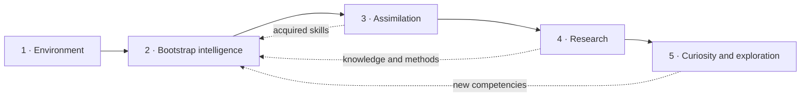
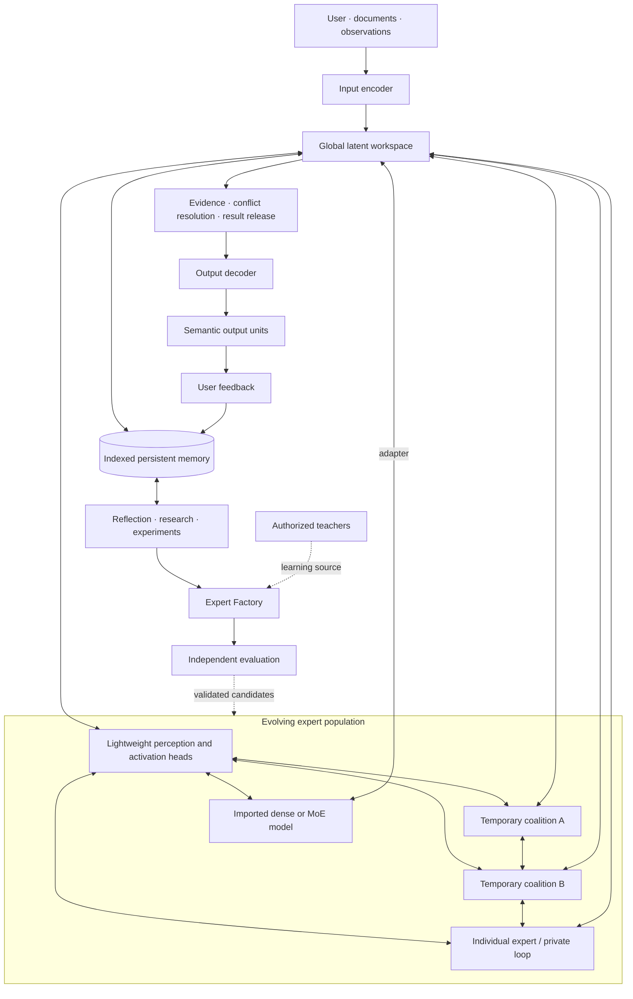
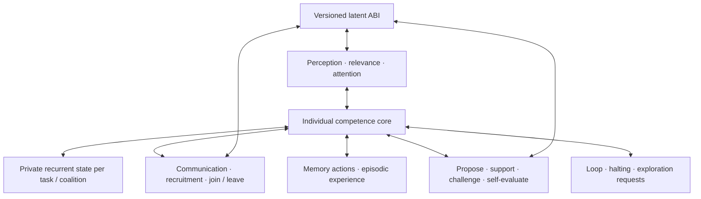
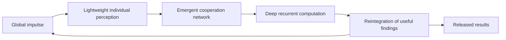
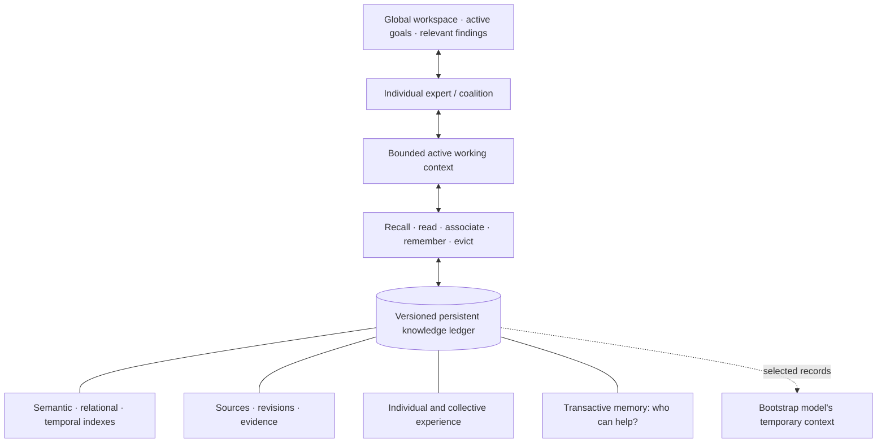
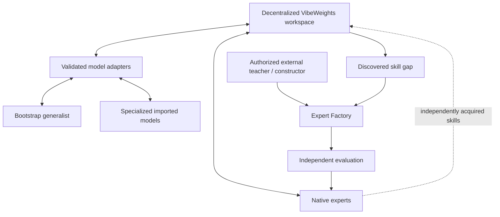
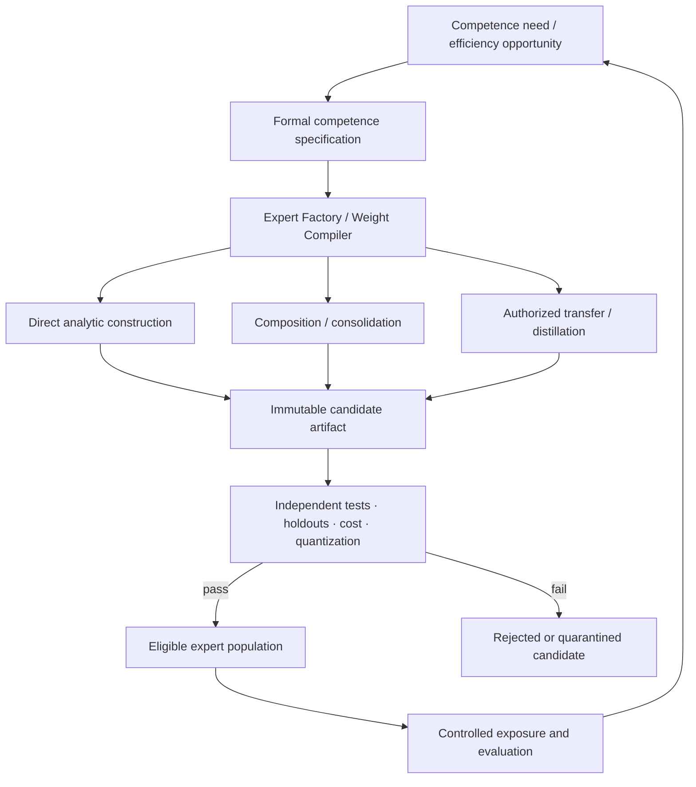
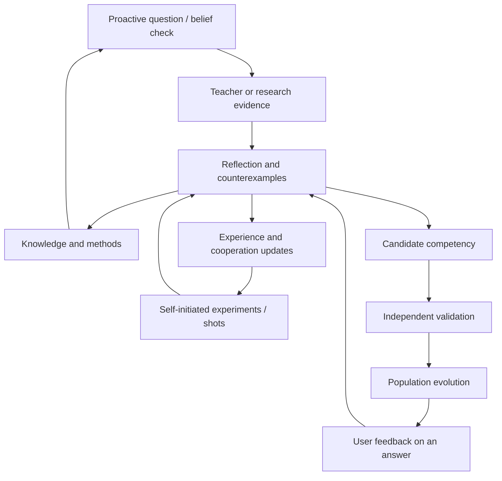
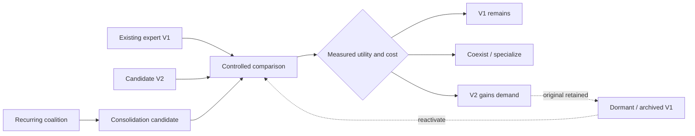
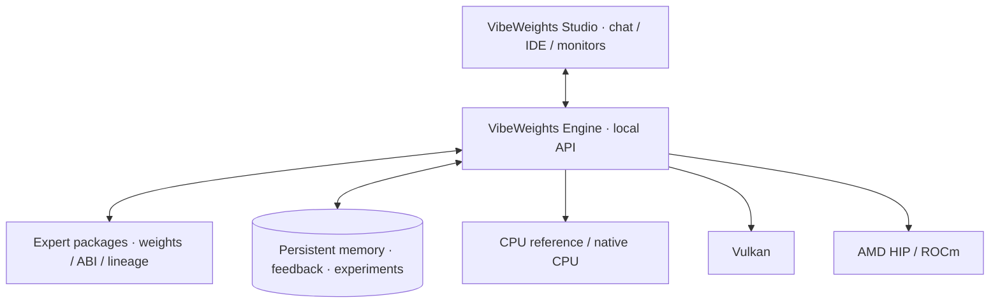

# VibeWeights

**A self-organizing, self-learning, self-optimizing and self-scaling neural ecosystem**


**Local-first AI research · Decentralized neural experts · Weight-space programming · Continual learning**

> **Research question:** Can intelligence grow through the self-organization, cooperation and continual evolution of independently constructed or imported neural competencies, rather than through repeated training of a single monolithic model?

VibeWeights explores an AI system that does not remain fixed after deployment. It should accumulate experience through ordinary use, discover new skills, learn from other models and research, develop new experts, reorganize its cooperation network and consolidate expensive competencies into more efficient ones. A larger hardware budget should enable more resident experts and deeper computation without requiring a redesign of the architecture.

The long-term ambition is a system that becomes more capable through use, with learning integrated into its normal lifecycle rather than exposed as a separate training environment the user must operate. **This is a research hypothesis, not a demonstrated property of the current prototype or a claim of AGI.**

[Architecture](#architecture) · [Memory](#memory-and-context) · [Expert Factory](#expert-factory-and-vibeweighting) · [Bootstrap and assimilation](#bootstrap-and-assimilation) · [Evolution](#continual-learning-and-evolution) · [Research](#research-foundations) · [Status](#current-implementation-v070) · [Quick start](#quick-start) · [Roadmap](#roadmap)

## 1. Why VibeWeights?

Conventional language models usually combine knowledge, skills, reasoning and language generation in one trained architecture. Even a sparse MoE normally has a fixed model topology and learned internal routing. VibeWeights investigates a different separation of concerns: competencies are independently addressable, the population can change, memory is external to any one expert's context window, and the amount of computation can depend on the problem instead of the number of generated tokens.

| Design dimension | VibeWeights hypothesis |
|---|---|
| Competence | Independently constructed, imported, specialized or distilled neural modules |
| Knowledge | Persistent, versioned and indexed records with evidence and relationships |
| Experience | Individual and collective episodes, feedback and cooperation history |
| Organization | Dynamic, context-dependent relationships and temporary coalitions |
| Reasoning | Recurrent latent state transitions at individual, group and system levels |
| Development | Validated creation, variation, consolidation and retirement of experts |

These dimensions should be able to scale independently. A new fact need not require changing weights; a new skill may require a new expert; a better cooperation pattern may need only updated relationships; a difficult task may require more iterations rather than a larger permanent model.

This is not a rejection of conventional models or training. Existing open-weight models and explicitly recorded distillation are useful bootstrap and learning mechanisms. The research question is whether a persistent, evolving ecosystem can acquire durable capabilities beyond its starting models.

## 2. Five development objectives

| Objective | Motivation and acceptance criterion |
|---|---|
| **1. Environment** | A stable, extensible runtime for independently developed modules. Demonstrate dynamic cooperation, memory, recurrence, feedback, variants, language interfaces and resource management through a unified application path. |
| **2. Bootstrap intelligence** | Establish enough language, abstraction, reasoning and verification capability to learn. Acquire a previously absent, defined competency from an authorized teacher and apply it to unseen tasks without that teacher. |
| **3. Assimilation** | Learn from existing models, retain their useful knowledge and methods, and reduce dependence on them. Demonstrate lasting transfer across several task classes. |
| **4. Research** | Learn from documentation, publications, observations and experiments with traceable sources and counterevidence. |
| **5. Curiosity and exploration** | Discover learning questions and competence gaps autonomously, run permitted experiments, and measure improvements under controlled budgets. |



The objectives are ordered development gates, not a rigid cognitive pipeline. After bootstrap they can reinforce one another. Passing a gate requires behavioral evidence, not merely an implemented interface.

## Architecture

### 3. Overall system — target architecture



*This diagram describes the target architecture. Several mechanisms, notably autonomous coalition formation, semantic alignment, autonomous learning and direct latent integration of imported models, remain research work.*

**No central cognitive router.** A technical scheduler, registry, event bus and resource manager may enforce execution contracts, delivery, permissions and budgets. They must not decide the substantive reasoning path, impose a permanent expert hierarchy or hide a central planning LLM. Experts determine their relevance and cooperation locally. Independent evaluation is a technical acceptance boundary, not a centralized cognitive controller.

### 4. The universal expert

The outer contract is standardized; the inner architecture is free. An expert may be a small analytically constructed MLP, a recurrent circuit, an associative network, a transformer, an SSM, an imported dense/MoE model or a distilled competency. There is no requirement that all experts have the same size or topology.



The intended application binary interface (ABI) includes entities, relationships, numeric values, goals, hypotheses, evidence, status, validity masks, stable identities and revisions. Private representations may have different dimensionalities. Numerical shape compatibility alone does not establish semantic compatibility: shared meanings and bidirectional adapters require independent tests.

Technical IDs and metadata can be strings; native reasoning communication is intended to be numerical, not a conversation of text prompts. Early symbolic reference heads must be identified as such.

### 5. Self-organization: global → detail → global



Every compatible expert should have an opportunity to perceive relevant global impulses through a small, inexpensive head. A specialist can orient itself using memory, offer a contribution, recruit others and perform a deeper forward pass when useful. Large shared payloads are referenced rather than copied to every participant.

- Groups are **emergent behavior**, not fixed architectural units. A task may involve one expert, several overlapping coalitions or a large part of the population. Experts may join, leave, split, merge and recursively recruit.
- Communication can be private, directed, local, regional or global. Experts in multiple contexts maintain separate state.
- Recurrence operates at four levels: private expert loops, coalition loops, inter-coalition loops and global reflection. Important new findings may trigger global reassessment at any time.
- There is no fixed global top-k, group size or number of steps per output token. Physical compute, memory, communication and time budgets remain mandatory.
- Convergence is not evidence of correctness. Stagnation, unresolved conflict, budget exhaustion and verified completion must be distinguishable.

Input and output are separate from thinking. The encoder should represent the task, not secretly solve it; the decoder should render approved semantic units and may request clarification. Reasoning can continue independently of token generation. Words, sentences, blocks and structured outputs are possible output formats, with explicit revision of earlier claims.

## Memory and context

### 6. An indexed, self-managed memory rather than one expanding context window



An expert should retrieve only the information it requires, associate it with current hypotheses, and release it from active memory when no longer needed. Persistent storage may grow independently of the active working state. Imported LLMs keep their own native context window and KV cache, but these are not the global memory of VibeWeights.

| Memory type | Intended role |
|---|---|
| Semantic | Facts, concepts and relationships |
| Episodic | Past interactions and problem-solving experiences |
| Procedural | Methods, algorithms and reusable solution patterns |
| Transactive | Which experts or coalitions helped in which situations |
| Reflective | Errors, feedback, corrections and lessons |
| Exploratory | Hypotheses, open questions and experiments |

Indexes should ultimately be maintained through learning: semantic similarity, directed associations, relations, time, provenance, competencies and experiences. Causal claims require evidence rather than mere association. Consolidation should produce traceable abstractions while retaining original sources and revisions.

**Implemented in v0.7.0:** SQLite records and current heads, exact indexes, directed versioned relations, logical global/group/private access, bounded per-expert views, explicit embedding-space cosine search, and numerical SEARCH, READ, RELATED, REMEMBER and EVICT actions. The REMEMBER path is restricted to authorized, independently verified results. There is no learned semantic encoder, autonomous reindexing or full transitive information-flow control yet. Logical budgets are not physical RAM guarantees.

See [Memory Architecture v0.7](docs/MEMORY_ARCHITECTURE_v07.md).

## Bootstrap and assimilation

### 7. Start with existing intelligence, then acquire independent capabilities

Instead of constructing all initial intelligence from scratch, VibeWeights may integrate a heterogeneous population of authorized open-weight models. A fast Qwen MoE in Q4 — potentially a 35B-class model — is a candidate for the initial generalist. Other models can contribute specialized reasoning, coding, mathematics, language or vision. Model selection, compatibility, licensing and actual performance remain to be tested.



There are two distinct levels of sparsity: self-organized participation among VibeWeights experts, and the internal sparse activation of an imported MoE model. An internal MoE router is permissible inside that model; it does not become the global router for the ecosystem. Sparse activation reduces computation relative to dense use of the same parameter count but does not eliminate storage, dispatch or memory-bandwidth costs.

The bootstrap model is a productive participant, not the same role as an external teacher or constructor. Initially the integration is an explicitly marked text bridge to a local compatible inference server. The research target is validated, bidirectional latent communication. Extracting hidden states without alignment is insufficient.

Assimilation may transfer facts into persistent memory, methods into reusable representations, bounded competencies into directly constructed networks, or learned behavior through explicitly recorded distillation. Copying individual internal MoE blocks does not automatically produce independent experts, since their function depends on the surrounding model.

The goal is to transfer **functional competencies**, not necessarily to dismantle the original model. Bootstrap models should remain available where they add unique value. They can be hibernated when independently evaluated alternatives are sufficient.

To establish independence, compare bootstrap alone, bootstrap plus VibeWeights, VibeWeights with bootstrap disabled, and VibeWeights with external teachers unavailable. Evaluate unseen tasks and retention after restart; rule out the encoder, decoder or oracle doing the actual work.

## Expert Factory and VibeWeighting

### 8. Creating new competencies

Weight-space programming (WSP) investigates constructing or editing neural weights through reasoning rather than exclusively optimizing them through examples. It is an important inspiration for VibeWeights, not an already solved general-purpose route to intelligence.

The proposed Expert Factory provides a technical construction interface that any authorized expert can request. Initially a capable external model or human can supply formal specifications and reusable weight generators. Over time, the bootstrap population should learn to parameterize those generators, combine known circuits, modify existing modules and eventually propose new construction procedures.



The Factory is not a central intelligence. It should execute approved construction methods and preserve lineage, hashes, ABI, resource requirements, license and evaluation evidence. Generated code or model outputs are untrusted proposals, not arbitrary privileged runtime instructions.

| Provenance | Meaning |
|---|---|
| DIRECT | Analytically or procedurally constructed weights without example-driven optimization |
| SYNTHESIS | Search or test-guided construction |
| PRETRAINED | Imported existing trained model |
| TRAINED | Explicit learning, optimization or distillation |
| SYMBOLIC | Rules, algorithms or reference logic, not neural weight competence |

Mixed artifacts must preserve the provenance of each component. A large tensor initialized without meaningful function is not a competence. The parameter budget is not a reason to pad a small successful network.

A declarative Weight Compiler should translate supported operations to executable weight matrices. The current implementation supports affine maps; general nonlinear construction and learning the construction process itself remain open.

## Continual learning and evolution

### 9. Learning during ordinary use



There are three complementary learning paths:

1. **Proactive inquiry:** an expert asks a teacher or investigates a belief; evidence can confirm, extend or correct it.
2. **User feedback:** a response receives a correction, preference or satisfaction signal; original and new experts may reflect, investigate and propose a revised answer. Satisfaction and factual correctness remain independent.
3. **Experiments:** experts discover new associations, test hypotheses, compare alternatives and propose new competencies.

Inference, reflection and learning should be internal activities of the same application, not separate manual environments. User requests take priority. Learning is interruptible and limited to explicitly authorized compute, time, storage and external access. Isolated evaluation and recovery remain necessary even when the user does not manage training manually.

### 10. Exploration, cooperation memory and attribution

The system should remember successful and unsuccessful partners in a context-dependent cooperation graph. Past cooperation is useful evidence, not a permanent hierarchy. Random exploration helps discover specialists that would otherwise never be activated.

Exploration Shots include random, cold/new-expert, diversity, stagnation and challenge probes. They should be reproducible when seeded, adapt to uncertainty and available resources, and avoid exhausting the core task budget. Current shots are limited probe mechanisms; general productive exploration is a research target.

Measure exposures, self-activations, invitations, actual contributions, verified corrections, unique competencies, cost, user satisfaction and marginal utility separately. Compare runs with and without a particular contribution under matched conditions. Frequent activation is not a proof of intelligence, nor should a whole coalition receive credit solely because the final answer was good.

### 11. Grow, specialize, consolidate, reactivate



Evolution is not only expansion. Frequently recurring collective competencies might be consolidated into a smaller network; specialized modules might be pruned, quantized or distilled to reduce cost. A replacement must demonstrate comparable or better behavior on independent tests, including rare capabilities. Originals and prior versions remain recoverable.

Variants can coexist, specialize or become dormant; popularity must not be the sole selection signal. Fair exposure for new candidates, independent validation, quarantine and rollback prevent a feedback loop from silently redefining success or discarding useful abilities.

A first exact case exists: for affine maps, composing a second map B with a first map A yields a single affine map with matrix BA and bias Ba + b. The prototype demonstrates seven parameters reduced to two, with 201 additional checked inputs. This is a bounded algebraic result, not evidence that arbitrary nonlinear expert networks can already be compressed.

## 12. Hardware, packaging and local operation

The intended deployment separates the runtime, interface, immutable model artifacts and evolving user data.



| Component | Target |
|---|---|
| Engine | Native C++ runtime with interchangeable compute backends; PyTorch remains the research/reference implementation |
| Studio | Chat, expert network visualization, memory explorer, learning and evolution monitors, benchmarks |
| Expert artifacts | Independently versioned SafeTensors reference weights, planned GGUF quantized inference artifacts, manifests and validation records |
| Persistent data | Separately retained knowledge, experience, feedback, configuration and backups |
| Distribution | Windows 11 x64 portable first; no separate Python install, WSL or Docker required in the eventual release; platform-specific builds with portable artifact formats |
| Hardware | AMD Ryzen AI Max+ 395 / Strix Halo as an initial optimization target; CPU fallback, Vulkan and HIP evaluation |

Q4 is the primary target for suitable inference kernels. Mixed precision remains necessary for sensitive heads, accumulations and other numerically critical operations. Quantized behavior must be independently tested. A GGUF container alone does not make an arbitrary architecture compatible with existing inference runtimes.

The initial planning example is around 512 experts with variable sizes (often 100–500M parameters); neither value is a fixed limit. Smaller and larger modules are welcome where justified by competence. At 200M average, 512 experts represent 102.4B parameters or about 47.7 GiB of **ideal raw Q4 weights**. At 500M average, 256B parameters require about 119.2 GiB. Real quantization metadata, imported models, caches, activation and runtime buffers add overhead.

A 96 GiB GPU-memory allocation on Strix Halo is a reference target, not a guarantee of fit or speed. The population may exceed resident memory: small perception heads can remain available while larger cores are loaded and cached on demand. More hardware should permit more resident experts or deeper processing, not force a new architecture.

## Research foundations

VibeWeights combines several established research directions and newer experimental ideas. The references below motivate specific mechanisms; they are not claims that the complete VibeWeights architecture already exists or works. Existing results have not been independently replicated by this project.

| Research direction / primary reference | Relevance to VibeWeights and boundary |
|---|---|
| [Sparks of Weight-Space Programming (Takehi et al., 2026)](https://rikiyat.github.io/blog/weight-space-programming/) | Direct weight construction/editing as an experimental mechanism. Reported bounded tasks and model edits do not establish arbitrary large expert synthesis. |
| [Recurrent Independent Mechanisms (Goyal et al., ICLR 2021)](https://mlanthology.org/iclr/2021/goyal2021iclr-recurrent/) | Separately recurrent mechanisms and selective interaction; inspiration for private state and sparse computation. |
| [Coordination Among Neural Modules Through a Shared Global Workspace (Goyal et al., 2021/22)](https://arxiv.org/abs/2103.01197) | Limited shared communication channel for specialist modules; motivates global/local workspaces and bandwidth budgets. |
| [LIDA cognitive model tutorial (2016)](https://www.sciencedirect.com/science/article/pii/S2212683X16300196), [codelets and coalitions](https://pmc.ncbi.nlm.nih.gov/articles/PMC9019476/) | Temporary coalitions and different memory systems; cognitive inspiration rather than a proof of native neural expert construction. |
| [Transactive memory review](https://onlinelibrary.wiley.com/doi/full/10.1111/tops.12359) | Memory of others' competence; motivates context-specific recruitment history. |
| [Contract Net Protocol (Smith, 1980)](https://www.scilit.com/publications/51c2fb8fa05bbe0abed48d2b35d3e689) | Decentralized task negotiation; inspiration for needs, offers and invitations, not a neural implementation. |
| [Neural Production Systems (2021)](https://papers.nips.cc/paper/2021/hash/d785bf9067f8af9e078b93cf26de2b54-Abstract.html) | Selective rule/entity interactions; informs typed semantic contracts. |
| [Expert Choice Routing (2022)](https://research.google/blog/mixture-of-experts-with-expert-choice-routing/) | Experts choosing inputs rather than only inputs choosing experts; still conventional MoE routing, not our population-level organization. |
| [DyLAN (2023)](https://arxiv.org/abs/2310.02170) | Dynamic language-agent teams as a comparison baseline, not native numerical coalitions. |
| [MemGPT (Packer et al., 2023)](https://arxiv.org/abs/2310.08560) | Hierarchical memory and managed context; motivates bounded working state and explicit memory operations. |
| [Coconut (Hao et al., 2024)](https://arxiv.org/abs/2412.06769) | Recurrent hidden-state reasoning without decoding every intermediate state to language; a trained LLM, not independent untrained experts. |
| [Scaling up Test-Time Compute with Latent Reasoning / recurrent depth (Geiping et al., 2025)](https://arxiv.org/abs/2502.05171) | Iterated latent blocks decouple reasoning compute from output length; motivates adaptive depth. |
| [FlexOLMo (2025)](https://proceedings.nips.cc/paper_files/paper/2025/hash/f2621bfa8b39cd3c5a361273aa7ec4db-Abstract-Conference.html) | Combining separately trained expert components; highlights compatibility and composition testing. |
| [Mixture of Thoughts (2025)](https://arxiv.org/abs/2509.21164), [LatentMAS (2025/26)](https://arxiv.org/abs/2511.20639) | Latent model collaboration and alignment; motivate adapter experiments without assuming arbitrary representations are interchangeable. |
| [Contextual bandits (Li et al., 2010)](https://arxiv.org/abs/1003.0146), [offline evaluation](https://arxiv.org/abs/1003.5956) | Context-sensitive exploration and evaluation under selection bias, not a proposed central bandit router. |
| [Counterfactual Multi-Agent Policy Gradients (Foerster et al., 2018)](https://ojs.aaai.org/index.php/AAAI/article/view/11794) | Individual contribution within collective outcomes; motivates controlled ablation, not a claim that COMA is implemented. |
| [Population Based Training (Jaderberg et al., 2017)](https://arxiv.org/abs/1711.09846) | Variation and selection; useful analogy despite being a training method rather than our proposed expert lifecycle. |
| [Distilling the Knowledge in a Neural Network (Hinton et al., 2015)](https://arxiv.org/abs/1503.02531) | Transfer and consolidation of behavior into smaller networks; explicitly distinguished from analytic weight construction. |

The full [research survey](docs/FORSCHUNG_2026-11-26.md) and [learning/evolution supplement](docs/FORSCHUNG_ERGAENZUNG_v05.md) contain further references, including recent WSP and latent-communication preprints, limitations and concrete experiment proposals. Very recent papers should be treated as preliminary. The project makes no claim of worldwide novelty, exhaustive literature coverage or general autonomous self-improvement.

## 13. Experimental program and falsifiable success criteria

| Research question | Control / evidence |
|---|---|
| Does decentralized cooperation help? | Compare fixed teams, centralized routing baseline and emergent cooperation at matched budgets. |
| Do recurrence and memory help? | Ablate loops, memory and retrieval; include unseen tasks and distractor records. |
| Does exploration discover useful new behavior? | Matched seeded runs with and without shots; measure quality as well as added cost. |
| Can a new expert replace a model dependency? | Compare teacher/bootstrap alone, combined system and independently functioning system after disabling the source model. |
| Does evolution improve efficiency? | Compare original and candidate under matched quality requirements, including rare tasks and peak memory. |
| Does ordinary use produce lasting improvement? | Compare a frozen starting system with a continually learning one over time, including retention, generalization and cost. |

Independent holdouts must not become synthesis inputs. Report failures as research results. Distinguish expert activation, causal contribution, user satisfaction, factual correctness, resource consumption and independent capability. Do not equate greater parameter count or test count with intelligence.

## Current implementation (v0.7.0)

**Goal 1 — Environment is in development; it has not passed the full acceptance gate.**

| Implemented / demonstrated | Scope |
|---|---|
| Analytically constructed native experts | Five small formal competence cores in the original reference path; 338 DIRECT parameters including heads and language functions |
| Numerical Environment slice | Separate hypotheses for competing versions, bounded processing and independent task-specific verifiers; opt-in runtime |
| Expert Factory | Affine compilation, persistent versioned SafeTensors catalog, hash checks, explicit candidate acceptance, demand loading with a file-byte limit |
| Analytic consolidation | Seven parameters reduced to two; 201 additional inputs checked |
| Exploration and feedback infrastructure | Seeded probes, telemetry, stored feedback and linked response revisions; not autonomous reflection |
| Indexed knowledge ledger | Immutable revisions, scopes, bounded views, exact indexes and explicit-vector retrieval |
| Memory reuse demonstration | 7 + recalled 6 = 13; verified result persisted and reused by another expert after restart with 1,000 distractors, giving 26 |
| Bootstrap adapter | Local OpenAI-compatible text transport with explicitly selected verified record references; test server only |
| Local regression evidence | 104 passing CPU tests, including 17 new tests, zero training steps in this version |

See [test summary](evidence/summary.json), [memory experiment](evidence/v07-memory-demo.json) and [technical implementation v0.6](docs/platform_v06.md).

**Not yet demonstrated:** general linguistic intelligence, autonomous coalition formation, a universal semantic ABI, unified production runtime, real Qwen inference, autonomous skill synthesis/assimilation, learned semantic indexing, automatic knowledge consolidation, full cross-database recovery, native Q4/GGUF computation, GPU acceleration or Windows portable operation. GitHub CI is configured; consult [Actions](https://github.com/Griggelor/VibeWeights/actions) for actual remote results rather than inferring them from the local test count.

The original narrow arithmetic chat/API remains the default reference path; the newer Environment and memory mechanisms are opt-in. The project is not yet a general-purpose chatbot or a runnable replacement for Qwen.

## Quick start

### Reference chat and tests

From the repository root (Windows / Linux, Python 3.12 or 3.13 intended):

```sh
python -m venv .venv
# Windows PowerShell: .venv\Scripts\Activate.ps1
# Linux: source .venv/bin/activate
python -m pip install -e ".[test]"
python -m pytest -q
python -m vibeweights.chat --journal sessions.sqlite --shots 3 --shot-seed 7
```

Examples for the deliberately limited German reference grammar:

```text
Ist 42 mindestens 30?
Ist 7 mal 6 mindestens 30?; Ist 8 mal 5 mindestens 41?
/feedback negative Bitte genauer formulieren
/revise Ist 7 mal 6 mindestens 30?
/feedback positive
/metrics
/history
/exit
```

`/revise` verknüpft eine manuell formulierte erneute Anfrage mit der vorherigen Antwort; es ist keine autonome Korrektur. Ohne explizite Pfadangabe werden Daten jetzt unter `Data/` relativ zum Projektroot abgelegt. Flüchtiger Testbetrieb: `--memory :memory: --journal :memory:`. Für ein eingebettetes `Application`-Objekt bleiben die alten expliziten Referenz-Defaults erhalten. Standardmäßig sind Shots aus; zum Experimentieren `--shots` und `--shot-seed` setzen. `--memory memory.sqlite --seed 42 6 Quelle` erzeugt einen versionierten numerischen Speichereintrag. Die lokale API (`--serve 8765`) bietet `/v1/ask`, `/v1/feedback`, `/v1/metrics`, `/v1/reflections`, `/health`. Nur Loopback, keine Authentifizierung zwischen lokalen Nutzern; nicht im Netz exponieren.

### New Environment slice, memory and bootstrap

```sh
python -m vibeweights.next demo 7
# Erwartet: status OK, value [15.0], getrennte Hypothesen.
python -m vibeweights.next memory-demo 7 --initialize --remember
# Erwartet: status OK, value [13.0], SEARCH/READ/REMEMBER/EVICT.
python -m vibeweights.next memory-demo -7
# Wiederabruf aus persistenter DB: value [-1.0].
# Nur bei bereits laufendem lokalem, kompatiblem Modellserver:
python -m vibeweights.next bootstrap --model MODEL_ID --port 1234 --text "Erkläre eine lineare Abbildung."
```

Das konkrete Modell (z. B. ein Qwen-MoE) wird außerhalb des Slices bereitgestellt. Kein automatischer Download; die Engine ersetzt den Modellserver noch nicht. Die Textbrücke ist eine frühe PRETRAINED-Integrationsstufe und nicht mit nativem latentem Austausch gleichzusetzen. Ziel ist eine heterogene Bootstrap-Population, die über unabhängige Kompetenzerwerbs- und Lehrer-offline-Tests zunehmend entbehrlich werden soll. Die Factory ist derzeit ein begrenzter Compiler für affine Schaltungen, kein universeller Weight-Space-Compiler.


The commands above are for the existing Python research prototype, not the future portable Studio. See the [German technical documentation](docs/MEMORY_ARCHITECTURE_v07.md) for detailed contracts and limitations.

## Roadmap

| Stage | Priority / deliverable |
|---|---|
| Public baseline | v0.7.0 source, weights and evidence imported; verify Windows/Linux CI |
| Unified Environment | Migrate the regular chat/API to the new core; generic events, dynamic topology, private recurrence, independent result release |
| Memory | Universal semantic ABI, source/relationship indexing, cooperation and feedback integration, recovery, physical budgets |
| Bootstrap | Real authorized local models; text vs latent adapter experiments, independent ablations |
| Factory and evolution | Declarative operator graphs, safe candidate generation, feedback reflection, learning jobs, consolidation and independently retained skill acquisition |
| Hardware and Studio | Q4 tests, GGUF, native CPU parity, Vulkan/HIP benchmarking on Strix Halo, cache, portable Windows release |
| Environment acceptance | End-to-end tests, followed by systematic bootstrap intelligence, assimilation, research and curiosity experiments |

See [development status and acceptance plan](docs/status.md) for implementation details.

## Documentation

The detailed project documents are currently primarily in German; this English overview is a consolidated introduction for international readers.

| Document | Scope |
|---|---|
| [Vision and architecture v0.5](docs/VISION_ARCHITEKTUR_v05.md) | Motivation, expert model, organization, learning, evaluation |
| [Architecture decisions v0.6](docs/ARCHITEKTUR_v06.md) | Bootstrap models, Factory, variable sizes, Q4, growth and consolidation; supersedes older conflicting assumptions |
| [Memory architecture v0.7](docs/MEMORY_ARCHITECTURE_v07.md) | Ledger, indexes, access, working context and memory experiment |
| [Platform v0.6](docs/platform_v06.md) | Numerical core, Factory, adapter, review status |
| [Platform v0.5](docs/platform_v05.md) | Reference runtime, API, telemetry and limits |
| [Research survey](docs/FORSCHUNG_2026-11-26.md) | Literature and implications |
| [Research supplement](docs/FORSCHUNG_ERGAENZUNG_v05.md) | Exploration, selection, learning and attribution |
| [Roadmap](docs/status.md) | Development priorities and acceptance |
| [Original project brief](docs/PROJEKTAUFTRAG.md) | Historical starting point |
| [Test evidence](evidence/summary.json) | Reproducible, bounded results |

## Contributions and license

VibeWeights is an experimental public research project. Reproducible counterexamples, independent evaluations, alternative architectures and well-scoped contributions are welcome. New competencies should carry provenance, test evidence, resource requirements and compatible licensing. Please distinguish an architectural proposal from measured behavior.

Project code, documentation and self-constructed weights are published under the [Apache License 2.0](LICENSE). Third-party dependencies and any subsequently imported models retain their own licenses and terms. No third-party pretrained weights are included in this baseline.
