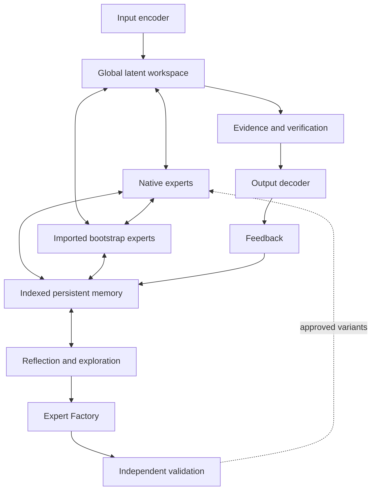

# VibeWeights

**A self-organizing, continuously learning and evolving neural ecosystem**

Experimental AI research · Local-first · Apache-2.0

VibeWeights investigates whether independently constructed and imported neural experts can acquire new capabilities through decentralized cooperation, persistent associative memory, exploration and validated evolution.

This is a research prototype, not a claim of AGI or demonstrated general autonomous self-improvement.

## Research objectives

1. **Environment:** a stable, extensible runtime for recurrent expert cooperation, memory, feedback, exploration and evolution.
2. **Bootstrap intelligence:** integrate heterogeneous open-weight models (dense or MoE) alongside directly constructed experts.
3. **Assimilation:** acquire durable capabilities from authorized teacher models and evaluate them independently of those teachers.
4. **Research:** acquire and verify knowledge and methods from external evidence.
5. **Curiosity:** initiate learning questions, experiments and improvements during normal operation within authorized resource budgets.

## Target architecture

Experts should form temporary, overlapping coalitions without a central cognitive router or fixed task hierarchy. The technical runtime manages resources, delivery and state integrity. Native numerical communication is the target; imported language models initially use an explicitly separate text bridge. The global workspace is not an ever-growing token window.

Expert evolution encompasses growth, specialization, composition, distillation, compression and reactivation. Candidate variants must demonstrate independent utility; originals remain recoverable. User satisfaction, factual correctness, causal contribution and cost must be evaluated separately.

## Engineering targets

- Independently versioned engine, Studio, expert artifacts and persistent memory.
- Portable Windows 11 x64 distribution; AMD Strix Halo as an initial optimization target.
- CPU reference backend, future Vulkan and HIP backends, Q4-first inference with mixed precision where needed.
- Variable expert sizes and population; roughly 512 experts of 100–500M parameters are a planning example, not a fixed limit.
- SafeTensors for reference weights, GGUF as a planned inference format; explicit provenance for direct synthesis, pretrained, trained and symbolic components.

## Development status

The prepared v0.7.0 baseline contains a Python/PyTorch CPU research prototype, a numerical environment slice, a limited analytic Expert Factory, versioned expert variants, a persistent indexed knowledge ledger and a local bootstrap-model HTTP adapter.

The supplied local evidence records 104 passing CPU tests, a limited affine expert consolidation from seven parameters to two, and a persistent memory retrieval/reuse experiment. These are bounded functional demonstrations, not proof of general intelligence.

**Repository bootstrap in progress:** this page is the initial project overview. The complete v0.7.0 source, weights, detailed architecture, research references, tests and CI configuration are not yet imported. GitHub CI, real Qwen inference, GPU acceleration and Windows portable execution are not yet verified.

## License

Project code and documentation are intended to be released under Apache-2.0. Imported third-party models and dependencies retain their respective license terms. No third-party model weights are part of the initial prototype.

See [LICENSE](LICENSE).
