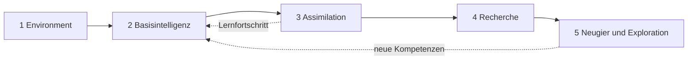
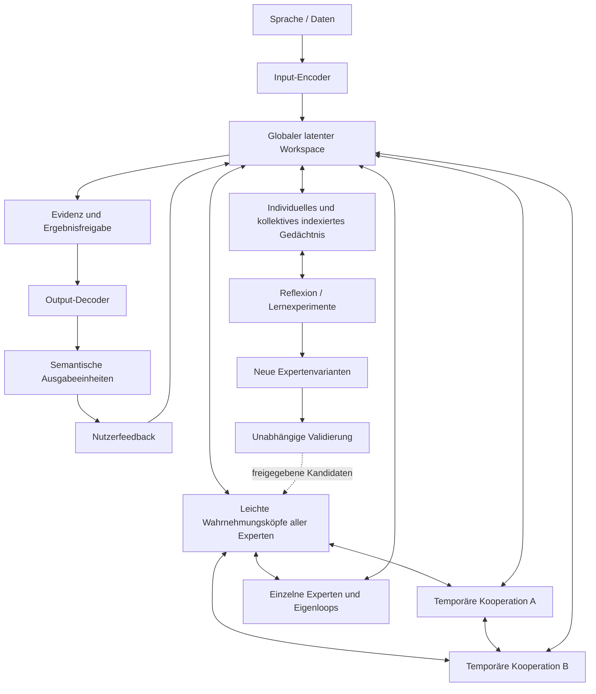
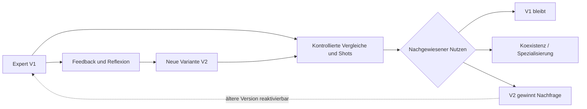

# VibeWeights

**A self-organizing, self-learning, self-optimizing and self-scaling neural ecosystem**

Experimentelles KI-Forschungsprojekt · Entwicklungsstand **v0.7.0** · 26.11.2026

> Forschungsfrage: Kann eine offene Population unabhängig konstruierter und importierter neuronaler Kompetenzen durch dezentrale Zusammenarbeit, Erfahrung und überprüfbare evolutionäre Entwicklung zunehmend komplexe Intelligenz erwerben?

VibeWeights ist weder ein klassisches Transformer-MoE noch eine sprachbasierte Multi-Agenten-Pipeline. Die Idee ist ein veränderliches neuronales Ökosystem, in dem Experten selbst entscheiden, wann sie mitarbeiten, sich an erfolgreiche Partner erinnern, in temporären Strukturen kooperieren und ihre Fähigkeiten perspektivisch weiterentwickeln. Wissen, Kompetenz, Erfahrung, Organisation und Rechenzeit werden getrennt skaliert. Das Projekt untersucht diese Hypothese; es behauptet weder AGI noch nachgewiesene autonome Selbstverbesserung.

## Die fünf Entwicklungsziele

| Ziel | Inhalt | Stand |
|---|---|---|
| 1. Environment | Dezentrale, rekurrente Plattform, Gedächtnis, Feedback, Exploration, Versionierung, Sprachschnittstellen | Referenzkern + Lerninfrastruktur in Entwicklung |
| 2. Basisintelligenz | Verstehen, Fragen, abstrahieren, prüfen und Kompetenzen synthetisieren | Kleine formale Experten; allgemeine Sprachfähigkeit offen |
| 3. Assimilation | Aktiv von zugelassenen Lehrmodellen lernen; selbstständig erworbene Fähigkeiten anwenden | Forschungsziel |
| 4. Recherche | Wissen und Methoden aus überprüfbaren Quellen erschließen | Forschungsziel |
| 5. Neugier & Exploration | Eigene Lernziele, Hypothesen und Experimente entwickeln | Erste zufällige Shots, autonome Neugier offen |



## Zielarchitektur



Es gibt keinen zentralen **kognitiven** Router. Die technische Runtime verwaltet Ereignisse, Zustandsintegrität, Ressourcen und sichere Ausführung, nicht die fachliche Lösung. Globale Wahrnehmung bedeutet nicht vollständige globale Berechnung. Gruppen können überlappen, sich spontan bilden oder auch ganz fehlen; 5–8 Mitglieder sind eine mögliche Beobachtung, keine Grenze. Auch alle 50 Reasoning-Experten einer hypothetischen Population dürfen bei Bedarf zusammenarbeiten, sofern das Budget reicht. Native Experten kommunizieren numerisch. Importierte LLMs verwenden zunächst eine ausdrücklich getrennte Textbrücke; direktes latentes Alignment bleibt offen. Denken und Ausgabe sind entkoppelt.

Die anfängliche Zielpopulation von etwa 512 variabel großen Experten (regulär 100–500M, als Planungsbeispiel durchschnittlich 200M) entspricht bei 200M im Mittel 102,4B Parametern bzw. theoretisch 47,68 GiB idealem Q4-Gewichtsspeicher (ohne Metadaten, Bootstrap-Modelle und Laufzeitpuffer). Q4 ist das primäre spätere Inference-Format. Sie ist weder eine Obergrenze noch ein Zwang zur künstlichen Parameterauffüllung. Referenz-Zielhardware: AMD Ryzen AI Max+ 395 / Strix Halo, Windows, 96 GiB GPU-Speicher; erste Tests auf Linux CPU.

## Lern- und Evolutionsprinzip



Erfahrung, Rekrutierung und zufällige Exploration sollen langfristig die Nachfrage nach Experten verändern. Aktivierungshäufigkeit ist eine Beobachtung, kein Wahrheits- oder Qualitätsbeweis. Nutzerzufriedenheit, fachliche Verifikation, individueller Beitrag, Ressourcenbedarf und kausaler Grenznutzen werden getrennt bewertet. Gewichte und Testkriterien werden nicht stillschweigend geändert.

## Was heute tatsächlich funktioniert – v0.7.0

- Unveränderte fünf kleine Kompetenzkerne der v0.5-Referenz, 338 DIRECT-Parameter inklusive Köpfe und Sprachfunktionen. Kein Training.
- Neuer separat ausführbarer numerischer Environment-Slice: unveränderliche Vektoren, freie Scope-Namen, unabhängige Verifikatoren, getrennte Hypothesen konkurrierender Versionen. Kein fachlicher Router im neuen Kern.
- Neue Expert Factory: analytische affine Gewichtskonstruktion, SHA-256-geprüfte SafeTensors, persistenter Katalog, parallele Instanz-IDs, Mehr-Eltern-Abstammung, explizite Kandidatenabnahme, Laden auf Anforderung mit Dateibyte-Limit.
- Erster Verdichtungsnachweis: zwei affine Module (7 Parameter) werden algebraisch zu einem Modul (2 Parameter) fusioniert, 201 zusätzliche ganzzahlige Eingaben geprüft, Originale erhalten. Kein allgemeiner Nachweis der Verdichtung nichtlinearer Kompetenzen.
- Lokale OpenAI-kompatible Textbrücke für Bootstrap-Dense-/MoE-Modelle; HTTP-Test mit lokalem Testserver bestanden, **kein reales Qwen geladen**. Ausgaben sind unverified proposals, keine freigegebenen Fakten. Kein autonomer Modellaufruf oder Training.
- Persistenter Datenroot in CLI-Standardeinstellungen; separate Bewertungs- und Präferenzkanäle; Kerntelemetrie bleibt bei Decoderfehler erhalten.
- Neue Memory Engine: versioniertes Wissensledger, separate Arbeitskontexte, logisch scoped Workspace, exakte Indexe und begrenzte Vektorsuche, native Speicheraktionen und autorisiertes REMEMBER verifizierter Ergebnisse. Wiederabruf und Folgeoperation mit 1.000 zusätzlichen Ablenkungsdatensätzen getestet.
- Bootstrap-Textadapter mit explizit ausgewählten verifizierten Kontextreferenzen; kein autonomer Abruf oder latentes Alignment.
- **104 lokale CPU-Tests bestanden.** Historische Chat-/API-Referenz bleibt vorerst Standard; neuer Slice wird explizit mit `vibeweights.next` ausgeführt. Kein vollständiger Austausch der v0.5-Runtime.

Nicht implementiert: allgemeines semantisches ABI, autonome Teilziel- und Gruppenbildung, vollständig integrierte neue Runtime, latenter LLM-Adapter, echtes autonomes Lernen und Expertensynthese, Q4/GGUF-Kernel, native GPU-Engine und portable Windows-Distribution. GitHub-CI und Strix Halo nicht ausgeführt.

## Schnellstart

Aus Repository-Root (Windows / Linux, Python 3.12 oder 3.13 vorgesehen):

```sh
python -m venv .venv
# Windows PowerShell: .venv\Scripts\Activate.ps1
# Linux: source .venv/bin/activate
python -m pip install -e ".[test]"
python -m pytest -q
python -m vibeweights.chat --journal sessions.sqlite --shots 3 --shot-seed 7
```

Beispiele für die begrenzte deutsche Referenzgrammatik:

```text
Ist 42 mindestens 30?
Ist 7 mal 6 mindestens 30?; Ist 8 mal 5 mindestens 41?
/feedback negative Bitte genauer formulieren
/revise Ist 7 mal 6 mindestens 30?
/feedback positive
/metrics
/history
/exit
```

`/revise` verknüpft eine manuell formulierte erneute Anfrage mit der vorherigen Antwort; es ist keine autonome Korrektur. Ohne explizite Pfadangabe werden Daten jetzt unter `Data/` relativ zum Projektroot abgelegt. Flüchtiger Testbetrieb: `--memory :memory: --journal :memory:`. Für ein eingebettetes `Application`-Objekt bleiben die alten expliziten Referenz-Defaults erhalten. Standardmäßig sind Shots aus; zum Experimentieren `--shots` und `--shot-seed` setzen. `--memory memory.sqlite --seed 42 6 Quelle` erzeugt einen versionierten numerischen Speichereintrag. Die lokale API (`--serve 8765`) bietet `/v1/ask`, `/v1/feedback`, `/v1/metrics`, `/v1/reflections`, `/health`. Nur Loopback, keine Authentifizierung zwischen lokalen Nutzern; nicht im Netz exponieren.

## Neuer Environment-Slice, Memory und Bootstrap

```sh
python -m vibeweights.next demo 7
# Erwartet: status OK, value [15.0], getrennte Hypothesen.
python -m vibeweights.next memory-demo 7 --initialize --remember
# Erwartet: status OK, value [13.0], SEARCH/READ/REMEMBER/EVICT.
python -m vibeweights.next memory-demo -7
# Wiederabruf aus persistenter DB: value [-1.0].
# Nur bei bereits laufendem lokalem, kompatiblem Modellserver:
python -m vibeweights.next bootstrap --model MODEL_ID --port 1234 --text "Erkläre eine lineare Abbildung."
```

Das konkrete Modell (z. B. ein Qwen-MoE) wird außerhalb des Slices bereitgestellt. Kein automatischer Download; die Engine ersetzt den Modellserver noch nicht. Die Textbrücke ist eine frühe PRETRAINED-Integrationsstufe und nicht mit nativem latentem Austausch gleichzusetzen. Ziel ist eine heterogene Bootstrap-Population, die über unabhängige Kompetenzerwerbs- und Lehrer-offline-Tests zunehmend entbehrlich werden soll. Die Factory ist derzeit ein begrenzter Compiler für affine Schaltungen, kein universeller Weight-Space-Compiler.

## Dokumentation und Forschung

| Dokument | Inhalt |
|---|---|
| [Memory Architecture v0.7](docs/MEMORY_ARCHITECTURE_v07.md) | Wissensledger, Indexe, Kontextvertrag, Zugriff, Speicherung, Tests und Grenzen |
| [Aktualisierte Zielarchitektur](docs/ARCHITEKTUR_v06.md) | Bootstrap, Q4, Portabilität, Wachstum und Verdichtung |
| [Vision und Architektur](docs/VISION_ARCHITEKTUR_v05.md) | Gesamtkonzept, Motivation, fünf Ziele, Lernwege, Diagramme, Forschungsfragen |
| [Technische Implementierung v0.6](docs/platform_v06.md) | Neuer Slice, Factory, Bootstrap, Reviewstatus und Grenzen |
| [Technische Implementierung v0.5](docs/platform_v05.md) | Tatsächlicher Pfad, Events, API, Metriken und Grenzen |
| [Forschungsübersicht](docs/FORSCHUNG_2026-11-26.md) | Quellen und Architekturfolgen aus bisheriger Recherche |
| [Forschungsergänzung](docs/FORSCHUNG_ERGAENZUNG_v05.md) | Exploration, evolutionäre Auswahl, aktive Lernwege und Evaluation |
| [Roadmap und Abnahme](docs/status.md) | Aktueller Stand, konkrete nächste Schritte |
| [GitHub-Import](docs/github_import.md) | Repository, CI und Release-Checkliste |
| [Testnachweise](evidence/summary.json) | Reale Testausführung, historische Nachweise getrennt |
| [Ursprünglicher Projektauftrag](docs/PROJEKTAUFTRAG.md) | Öffentliche Zusammenfassung des historischen Ursprungs |

Forschungsbezüge: RIMs, Shared Global Workspace, LIDA, Transactive Memory, Contract Net, Coconut, Huginn, MemGPT, Weight-Space Programming u.a. Die Kombination ist eine eigenständige Forschungshypothese; eine weltweite Neuheit ist nicht belegt. Keine fremden Forschungsergebnisse unabhängig repliziert.

Projektcode und selbst konstruierte Gewichte: Apache-2.0, siehe [LICENSE](LICENSE). Fremdmodelle und Abhängigkeiten behalten ihre jeweiligen Lizenzbedingungen. Keine vortrainierten Fremdgewichte enthalten. GitHub Pages ist nicht eingerichtet.
