# VibeWeights

**A self-organizing, self-learning, self-optimizing and self-scaling neural ecosystem**


**Local-first AI research · Decentralized neural experts · Weight-space programming · Continual learning**

> **Research question:** Can intelligence grow through the self-organization, cooperation and continual evolution of independently constructed or imported neural competencies, rather than through repeated training of a single monolithic model?

VibeWeights explores an AI system that does not remain fixed after deployment. It should accumulate experience through ordinary use, discover new skills, learn from other models and research, develop new experts, reorganize its cooperation network and consolidate expensive competencies into more efficient ones. A larger hardware budget should enable more resident experts and deeper computation without requiring a redesign of the architecture.

The long-term ambition is a system that becomes more capable through use, with learning integrated into its normal lifecycle rather than exposed as a separate training environment the user must operate. **This is a research hypothesis, not a demonstrated property of the current prototype or a claim of AGI.**

[Architecture](#architecture) · [Memory](#memory-and-context) · [Expert Factory](#expert-factory-and-vibeweighting) · [Bootstrap and assimilation](#bootstrap-and-assimilation) · [Evolution](#continual-learning-and-evolution) · [Research](#research-foundations) · [Status](#current-implementation-v070) · [Quick start](#quick-start) · [Roadmap](#roadmap)

## Why VibeWeights?

Conventional language models usually combine knowledge, skills, reasoning and language generation in one trained architecture. Even a sparse MoE normally has a fixed model topology and learned internal routing. VibeWeights investigates a different separation of concerns: competencies are independently addressable, the population can change, memory is external to any one expert's context window, and the amount of computation can depend on the problem instead of the number of generated tokens.

| Design dimension | VibeWeights hypothesis |
|---|---|
| Competence | Independently constructed, imported, specialized or distilled neural modules |
| Knowledge | Persistent, versioned and indexed records with evidence and relationships |
| Experience | Individual and collective episodes, feedback and cooperation history |
| Organization | Dynamic, context-dependent relationships and temporary coalitions |
| Reasoning | Recurrent latent state transitions at individual, group and system levels |
| Development | Validated creation, variation, consolidation and retirement of experts |

These dimensions should be able to scale independently. A new fact need not require changing weights; a new skill may require a new expert; a better cooperation pattern may need only updated relationships; a difficult task may require more iterations rather than a larger permanent model.

This is not a rejection of conventional models or training. Existing open-weight models and explicitly recorded distillation are useful bootstrap and learning mechanisms. The research question is whether a persistent, evolving ecosystem can acquire durable capabilities beyond its starting models.

## Five development objectives

| Objective | Motivation and acceptance criterion |
|---|---|
| **1. Environment** | A stable, extensible runtime for independently developed modules. Demonstrate dynamic cooperation, memory, recurrence, feedback, variants, language interfaces and resource management through a unified application path. |
| **2. Bootstrap intelligence** | Establish enough language, abstraction, reasoning and verification capability to learn. Acquire a previously absent, defined competency from an authorized teacher and apply it to unseen tasks without that teacher. |
| **3. Assimilation** | Learn from existing models, retain their useful knowledge and methods, and reduce dependence on them. Compare behavioral, structural (multi-scale fragments) and weight-space assimilation; demonstrate lasting transfer across several task classes. |
| **4. Research** | Learn from documentation, publications, observations and experiments with traceable sources and counterevidence. |
| **5. Curiosity and exploration** | Discover learning questions and competence gaps autonomously, run permitted experiments, and measure improvements under controlled budgets. |

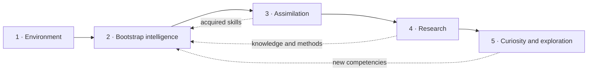

The objectives are ordered development gates, not a rigid cognitive pipeline. After bootstrap they can reinforce one another. Passing a gate requires behavioral evidence, not merely an implemented interface.

## Architecture

### Overall system — target architecture

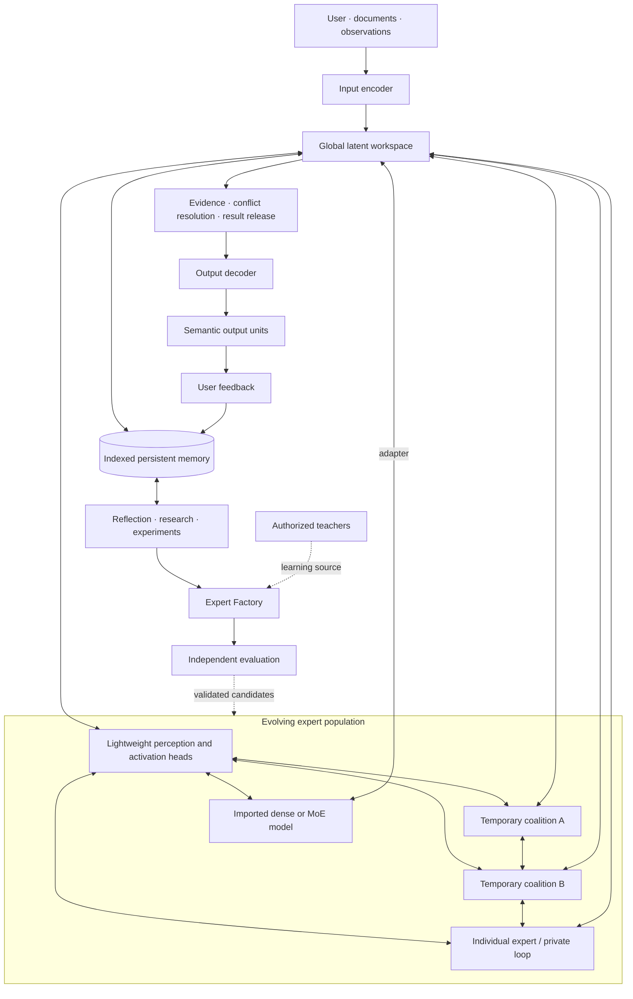

*This diagram describes the target architecture. Several mechanisms, notably autonomous coalition formation, semantic alignment, autonomous learning and direct latent integration of imported models, remain research work.*

**No central cognitive router.** A technical scheduler, registry, event bus and resource manager may enforce execution contracts, delivery, permissions and budgets. They must not decide the substantive reasoning path, impose a permanent expert hierarchy or hide a central planning LLM. Experts determine their relevance and cooperation locally. Independent evaluation is a technical acceptance boundary, not a centralized cognitive controller.

### The universal expert

The outer contract is standardized; the inner architecture is free. An expert may be a small analytically constructed MLP, a recurrent circuit, an associative network, a transformer, an SSM, an imported dense/MoE model or a distilled competency. There is no requirement that all experts have the same size or topology.

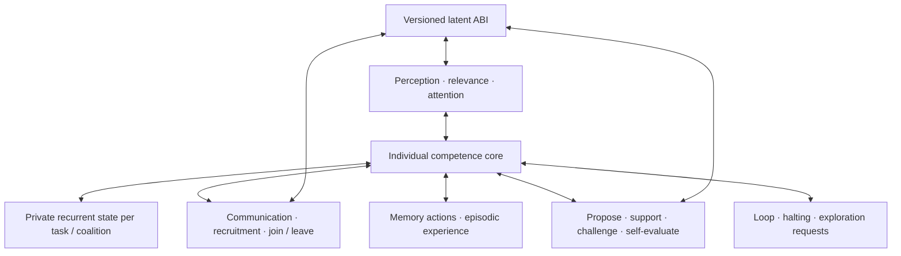

The intended application binary interface (ABI) includes entities, relationships, numeric values, goals, hypotheses, evidence, status, validity masks, stable identities and revisions. Private representations may have different dimensionalities. Numerical shape compatibility alone does not establish semantic compatibility: shared meanings and bidirectional adapters require independent tests.

Technical IDs and metadata can be strings; native reasoning communication is intended to be numerical, not a conversation of text prompts. Early symbolic reference heads must be identified as such.

### Self-organization: global → detail → global

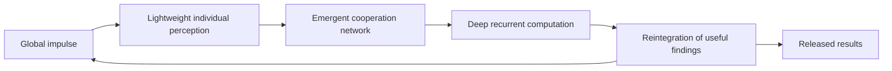

Every compatible expert should have an opportunity to perceive relevant global impulses through a small, inexpensive head. A specialist can orient itself using memory, offer a contribution, recruit others and perform a deeper forward pass when useful. Large shared payloads are referenced rather than copied to every participant.

- Groups are **emergent behavior**, not fixed architectural units. A task may involve one expert, several overlapping coalitions or a large part of the population. Experts may join, leave, split, merge and recursively recruit.
- Communication can be private, directed, local, regional or global. Experts in multiple contexts maintain separate state.
- Recurrence operates at four levels: private expert loops, coalition loops, inter-coalition loops and global reflection. Important new findings may trigger global reassessment at any time.
- There is no fixed global top-k, group size or number of steps per output token. Physical compute, memory, communication and time budgets remain mandatory.
- Convergence is not evidence of correctness. Stagnation, unresolved conflict, budget exhaustion and verified completion must be distinguishable.

Input and output are separate from thinking. The encoder should represent the task, not secretly solve it; the decoder should render approved semantic units and may request clarification. Reasoning can continue independently of token generation. Words, sentences, blocks and structured outputs are possible output formats, with explicit revision of earlier claims.

## Memory and context

### An indexed, self-managed memory rather than one expanding context window

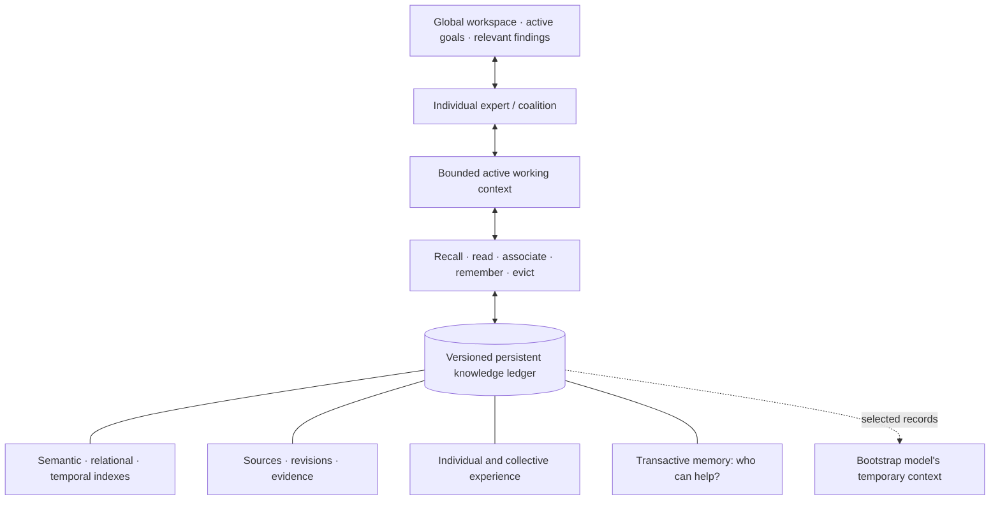

An expert should retrieve only the information it requires, associate it with current hypotheses, and release it from active memory when no longer needed. Persistent storage may grow independently of the active working state. Imported LLMs keep their own native context window and KV cache, but these are not the global memory of VibeWeights.

| Memory type | Intended role |
|---|---|
| Semantic | Facts, concepts and relationships |
| Episodic | Past interactions and problem-solving experiences |
| Procedural | Methods, algorithms and reusable solution patterns |
| Transactive | Which experts or coalitions helped in which situations |
| Reflective | Errors, feedback, corrections and lessons |
| Exploratory | Hypotheses, open questions and experiments |

Indexes should ultimately be maintained through learning: semantic similarity, directed associations, relations, time, provenance, competencies and experiences. Causal claims require evidence rather than mere association. Consolidation should produce traceable abstractions while retaining original sources and revisions.

**Implemented in v0.7.0:** SQLite records and current heads, exact indexes, directed versioned relations, logical global/group/private access, bounded per-expert views, explicit embedding-space cosine search, and numerical SEARCH, READ, RELATED, REMEMBER and EVICT actions. The REMEMBER path is restricted to authorized, independently verified results. There is no learned semantic encoder, autonomous reindexing or full transitive information-flow control yet. Logical budgets are not physical RAM guarantees.

See [Memory Architecture v0.7](docs/MEMORY_ARCHITECTURE_v07.md).

## Bootstrap and assimilation

### Start with existing intelligence, then acquire independent capabilities

Instead of constructing all initial intelligence from scratch, VibeWeights may integrate a heterogeneous population of authorized open-weight models. A fast Qwen MoE in Q4 — potentially a 35B-class model — is a candidate for the initial generalist. Other models can contribute specialized reasoning, coding, mathematics, language or vision. Model selection, compatibility, licensing and actual performance remain to be tested.

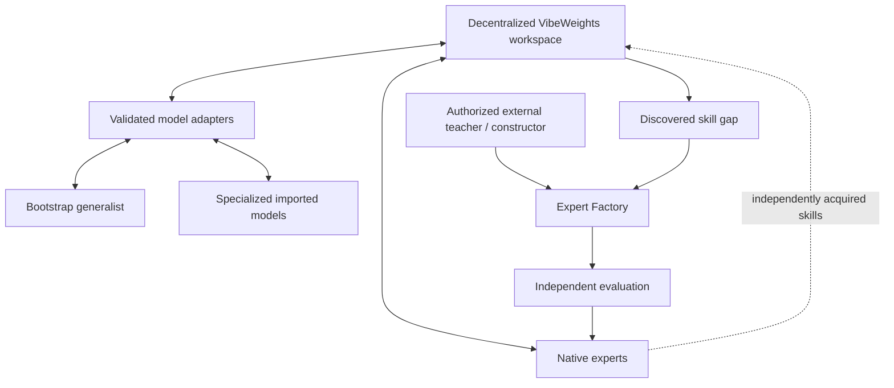

There are two distinct levels of sparsity: self-organized participation among VibeWeights experts, and the internal sparse activation of an imported MoE model. An internal MoE router is permissible inside that model; it does not become the global router for the ecosystem. Sparse activation reduces computation relative to dense use of the same parameter count but does not eliminate storage, dispatch or memory-bandwidth costs.

The bootstrap model is a productive participant, not the same role as an external teacher or constructor. Initially the integration is an explicitly marked text bridge to a local compatible inference server. The research target is validated, bidirectional latent communication. Extracting hidden states without alignment is insufficient.

Assimilation may transfer facts into persistent memory, methods into reusable representations, bounded competencies into directly constructed networks, or learned behavior through explicitly recorded distillation. Copying individual internal MoE blocks does not automatically produce independent experts, since their function depends on the surrounding model.

### Multi-scale fragment assimilation — research objective

In addition to behavioral assimilation (teachers) and weight-space assimilation (analysis, extraction and synthesis), structural assimilation tests whether pretrained model fragments become useful autonomous experts through local perception heads, latent input/output adapters and voluntary cooperation. Compare blind parameter-size cuts (~100M / ~130M / ~255M), structure-preserving blind cuts, intelligently proposed cuts and hybrids. Keep initial redundancy; consolidate additively and archive only through independent selection.

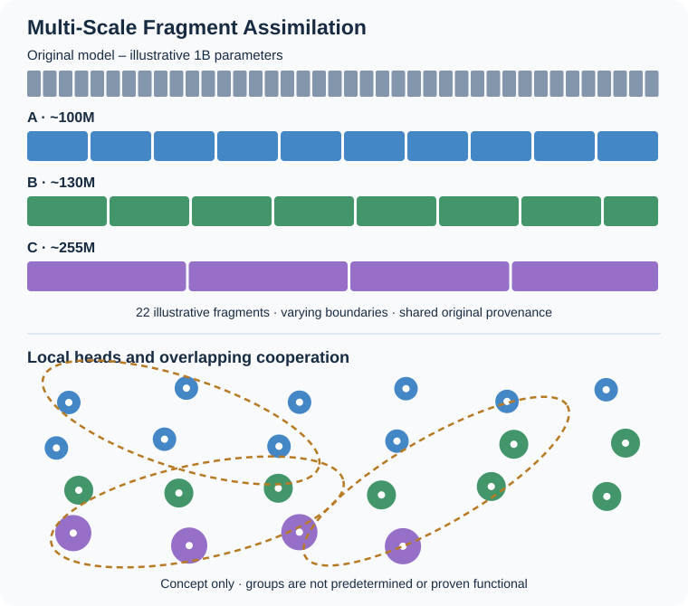

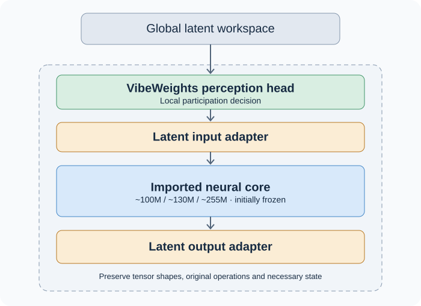

Start with a small open-weights model such as Qwen3-0.6B-Base. First establish exact reconstruction of the original model, then evaluate fragment assimilation without the intact teacher, randomized-core controls, adapter-only controls, fixed vs self-organized cooperation and budget-matched distillation. **This is a research hypothesis, not a demonstrated capability.** See the [experiment and acceptance contract](docs/FRAGMENT_ASSIMILATION.md).

The goal is to transfer **functional competencies**, not necessarily to dismantle the original model. Bootstrap models should remain available where they add unique value. They can be hibernated when independently evaluated alternatives are sufficient.

To establish independence, compare bootstrap alone, bootstrap plus VibeWeights, VibeWeights with bootstrap disabled, and VibeWeights with external teachers unavailable. Evaluate unseen tasks and retention after restart; rule out the encoder, decoder or oracle doing the actual work.

## Knowledge-first continual learning

**Immediate research priority:** teach the ecosystem to acquire verified concrete knowledge and established methods, and consolidate them into durable neural weights, before attempting autonomous changes to its intelligence architecture.

Fast learning in the indexed ledger and slower parametric consolidation are complementary. Initially keep productive experts and bootstrap weights immutable; create small, separate DIRECT or TRAINED candidates. New knowledge must have traceable evidence, validity, scope and permitted use. Model consensus and user satisfaction alone are not truth oracles.

The first vertical experiment will compare memory-only retrieval, directly constructed associative weights and locally trained small experts on a controlled knowledge domain. Demonstrate retention after restart with teacher, bootstrap and target-answer retrieval disabled, then ablate the candidate to identify what the new weights actually contribute. Separately test corrections, unknown inputs, sequential knowledge packages, old and rare abilities, cost and recovery from failures. A remembered fact is not by itself evidence of general reasoning improvement.

Use independent frozen holdouts, isolated candidate execution, staged release, replay, versioned artifacts, source-to-weight dependency tracking, revocation and rollback. Learning should be an interruptible activity of the ordinary application, not an unbounded or privileged self-modification loop.

The hypothesis is that improved knowledge, cooperation and consolidation can also improve later learning and generalization. That must be evaluated against a frozen learning strategy at matched budgets.

See the [Knowledge-first learning and validation contract](docs/KNOWLEDGE_FIRST_LEARNING.md) for the detailed safeguards, early acceptance experiment and additional research references (SERAC, GRACE, Progress & Compress, Voyager, Knowledge-Centric Self-Improvement and continual-learning evaluation).

## Expert Factory and VibeWeighting

### Creating new competencies

Weight-space programming (WSP) investigates constructing or editing neural weights through reasoning rather than exclusively optimizing them through examples. It is an important inspiration for VibeWeights, not an already solved general-purpose route to intelligence.

The proposed Expert Factory provides a technical construction interface that any authorized expert can request. Initially a capable external model or human can supply formal specifications and reusable weight generators. Over time, the bootstrap population should learn to parameterize those generators, combine known circuits, modify existing modules and eventually propose new construction procedures.

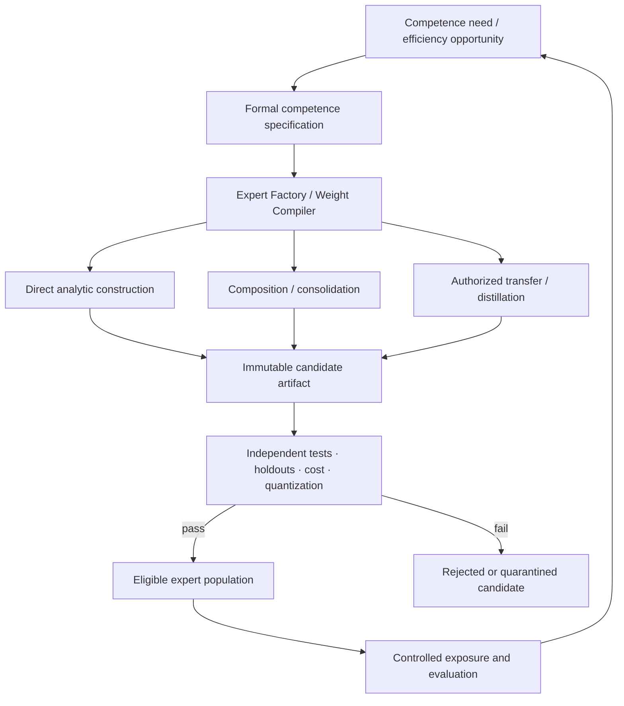

The Factory is not a central intelligence. It should execute approved construction methods and preserve lineage, hashes, ABI, resource requirements, license and evaluation evidence. Generated code or model outputs are untrusted proposals, not arbitrary privileged runtime instructions.

| Provenance | Meaning |
|---|---|
| DIRECT | Analytically or procedurally constructed weights without example-driven optimization |
| SYNTHESIS | Search or test-guided construction |
| PRETRAINED | Imported existing trained model |
| TRAINED | Explicit learning, optimization or distillation |
| SYMBOLIC | Rules, algorithms or reference logic, not neural weight competence |

Mixed artifacts must preserve the provenance of each component. A large tensor initialized without meaningful function is not a competence. The parameter budget is not a reason to pad a small successful network.

A declarative Weight Compiler should translate supported operations to executable weight matrices. The current implementation supports affine maps; general nonlinear construction and learning the construction process itself remain open.

## Continual learning and evolution

### Learning during ordinary use

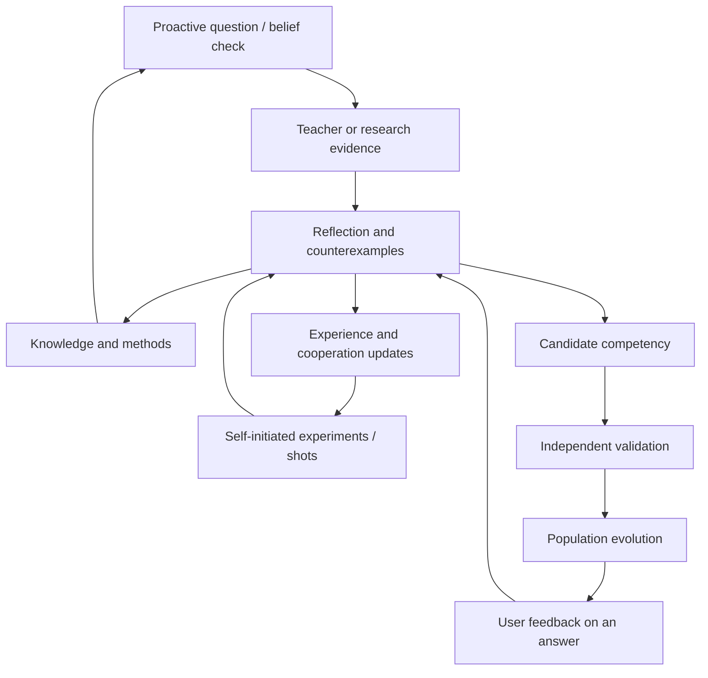

There are three complementary learning paths:

1. **Proactive inquiry:** an expert asks a teacher or investigates a belief; evidence can confirm, extend or correct it.
2. **User feedback:** a response receives a correction, preference or satisfaction signal; original and new experts may reflect, investigate and propose a revised answer. Satisfaction and factual correctness remain independent.
3. **Experiments:** experts discover new associations, test hypotheses, compare alternatives and propose new competencies.

Inference, reflection and learning should be internal activities of the same application, not separate manual environments. User requests take priority. Learning is interruptible and limited to explicitly authorized compute, time, storage and external access. Isolated evaluation and recovery remain necessary even when the user does not manage training manually.

### Exploration, cooperation memory and attribution

The system should remember successful and unsuccessful partners in a context-dependent cooperation graph. Past cooperation is useful evidence, not a permanent hierarchy. Random exploration helps discover specialists that would otherwise never be activated.

Exploration Shots include random, cold/new-expert, diversity, stagnation and challenge probes. They should be reproducible when seeded, adapt to uncertainty and available resources, and avoid exhausting the core task budget. Current shots are limited probe mechanisms; general productive exploration is a research target.

Measure exposures, self-activations, invitations, actual contributions, verified corrections, unique competencies, cost, user satisfaction and marginal utility separately. Compare runs with and without a particular contribution under matched conditions. Frequent activation is not a proof of intelligence, nor should a whole coalition receive credit solely because the final answer was good.

### Grow, specialize, consolidate, reactivate

**Additive learning, additive consolidation, independent evolutionary selection.** Learning adds a new expert or version. Consolidation adds a new aggregate expert representing tested combined competencies; it never replaces, disables or deletes its parents. Both original and aggregate experts remain available and compete fairly. Only a separate population-level selection mechanism may change residency or retire experts based on sustained verified contribution, unique and rare competencies, counterfactual ablations, dependencies and resource costs. Low activation alone is not sufficient. Normal evolution uses exactly three expert states: **ACTIVE (VRAM)**, **LOW_ACTIVE_IMPORTANT (VRAM)** and **ARCHIVED (SSD)**. Rare but important competencies remain GPU-resident. Archived experts retain complete immutable artifacts and dependencies on SSD and remain discoverable for recruitment and budgeted reactivation. There is no separate CPU-RAM residency tier on Strix Halo. Temporary staging buffers are implementation details. VRAM pressure must not silently evict important experts; bound learning and admission rather than bypass selection. No evolutionary operation physically deletes experts. SSD exhaustion limits new learning rather than silently deleting old competencies. Evidence-based quarantine remains a separate safety mechanism.

See the [learning and selection contract](docs/KNOWLEDGE_FIRST_LEARNING.md#4a-verbindliche-trennung-additive-lernoperationen-und-evolutionäre-reduktion).


Evolution is not only expansion. Frequently recurring collective competencies might be consolidated into a smaller network; specialized modules might be pruned, quantized or distilled to reduce cost. A replacement must demonstrate comparable or better behavior on independent tests, including rare capabilities. Originals and prior versions remain recoverable.

Variants can coexist, specialize or be archived; popularity must not be the sole selection signal. Fair exposure for new candidates, independent validation, quarantine and rollback prevent a feedback loop from silently redefining success or discarding useful abilities.

A first exact case exists: for affine maps, composing a second map B with a first map A yields a single affine map with matrix BA and bias Ba + b. The prototype demonstrates seven parameters reduced to two, with 201 additional checked inputs. This is a bounded algebraic result, not evidence that arbitrary nonlinear expert networks can already be compressed.

## Hardware, packaging and local operation

The intended deployment separates the runtime, interface, immutable model artifacts and evolving user data.

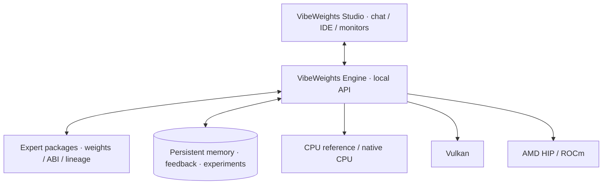

| Component | Target |
|---|---|
| Engine | Native C++ runtime with interchangeable compute backends; PyTorch remains the research/reference implementation |
| Studio | Chat, expert network visualization, memory explorer, learning and evolution monitors, benchmarks |
| Expert artifacts | Independently versioned SafeTensors reference weights, planned GGUF quantized inference artifacts, manifests and validation records |
| Persistent data | Separately retained knowledge, experience, feedback, configuration and backups |
| Distribution | Windows 11 x64 portable first; no separate Python install, WSL or Docker required in the eventual release; platform-specific builds with portable artifact formats |
| Hardware | AMD Ryzen AI Max+ 395 / Strix Halo as an initial optimization target; CPU fallback, Vulkan and HIP evaluation |

Q4 is the primary target for suitable inference kernels. Mixed precision remains necessary for sensitive heads, accumulations and other numerically critical operations. Quantized behavior must be independently tested. A GGUF container alone does not make an arbitrary architecture compatible with existing inference runtimes.

The initial planning example is around 512 experts with variable sizes (often 100–500M parameters); neither value is a fixed limit. Smaller and larger modules are welcome where justified by competence. At 200M average, 512 experts represent 102.4B parameters or about 47.7 GiB of **ideal raw Q4 weights**. At 500M average, 256B parameters require about 119.2 GiB. Real quantization metadata, imported models, caches, activation and runtime buffers add overhead.

A 96 GiB GPU-memory allocation on Strix Halo is a reference target, not a guarantee of fit or speed. The population may exceed resident memory: small perception heads can remain available while larger cores are loaded and cached on demand. More hardware should permit more resident experts or deeper processing, not force a new architecture.

## Research foundations

VibeWeights combines several established research directions and newer experimental ideas. The references below motivate specific mechanisms; they are not claims that the complete VibeWeights architecture already exists or works. Existing results have not been independently replicated by this project.

| Research direction / primary reference | Relevance to VibeWeights and boundary |
|---|---|
| [Sparks of Weight-Space Programming (Takehi et al., 2026)](https://rikiyat.github.io/blog/weight-space-programming/) | Direct weight construction/editing as an experimental mechanism. Reported bounded tasks and model edits do not establish arbitrary large expert synthesis. |
| [Recurrent Independent Mechanisms (Goyal et al., ICLR 2021)](https://mlanthology.org/iclr/2021/goyal2021iclr-recurrent/) | Separately recurrent mechanisms and selective interaction; inspiration for private state and sparse computation. |
| [Coordination Among Neural Modules Through a Shared Global Workspace (Goyal et al., 2021/22)](https://arxiv.org/abs/2103.01197) | Limited shared communication channel for specialist modules; motivates global/local workspaces and bandwidth budgets. |
| [LIDA cognitive model tutorial (2016)](https://www.sciencedirect.com/science/article/pii/S2212683X16300196), [codelets and coalitions](https://pmc.ncbi.nlm.nih.gov/articles/PMC9019476/) | Temporary coalitions and different memory systems; cognitive inspiration rather than a proof of native neural expert construction. |
| [Transactive memory review](https://onlinelibrary.wiley.com/doi/full/10.1111/tops.12359) | Memory of others' competence; motivates context-specific recruitment history. |
| [Contract Net Protocol (Smith, 1980)](https://www.scilit.com/publications/51c2fb8fa05bbe0abed48d2b35d3e689) | Decentralized task negotiation; inspiration for needs, offers and invitations, not a neural implementation. |
| [Neural Production Systems (2021)](https://papers.nips.cc/paper/2021/hash/d785bf9067f8af9e078b93cf26de2b54-Abstract.html) | Selective rule/entity interactions; informs typed semantic contracts. |
| [Expert Choice Routing (2022)](https://research.google/blog/mixture-of-experts-with-expert-choice-routing/) | Experts choosing inputs rather than only inputs choosing experts; still conventional MoE routing, not our population-level organization. |
| [DyLAN (2023)](https://arxiv.org/abs/2310.02170) | Dynamic language-agent teams as a comparison baseline, not native numerical coalitions. |
| [MemGPT (Packer et al., 2023)](https://arxiv.org/abs/2310.08560) | Hierarchical memory and managed context; motivates bounded working state and explicit memory operations. |
| [Coconut (Hao et al., 2024)](https://arxiv.org/abs/2412.06769) | Recurrent hidden-state reasoning without decoding every intermediate state to language; a trained LLM, not independent untrained experts. |
| [Scaling up Test-Time Compute with Latent Reasoning / recurrent depth (Geiping et al., 2025)](https://arxiv.org/abs/2502.05171) | Iterated latent blocks decouple reasoning compute from output length; motivates adaptive depth. |
| [FlexOLMo (2025)](https://proceedings.nips.cc/paper_files/paper/2025/hash/f2621bfa8b39cd3c5a361273aa7ec4db-Abstract-Conference.html) | Combining separately trained expert components; highlights compatibility and composition testing. |
| [Mixture of Thoughts (2025)](https://arxiv.org/abs/2509.21164), [LatentMAS (2025/26)](https://arxiv.org/abs/2511.20639) | Latent model collaboration and alignment; motivate adapter experiments without assuming arbitrary representations are interchangeable. |
| [Contextual bandits (Li et al., 2010)](https://arxiv.org/abs/1003.0146), [offline evaluation](https://arxiv.org/abs/1003.5956) | Context-sensitive exploration and evaluation under selection bias, not a proposed central bandit router. |
| [Counterfactual Multi-Agent Policy Gradients (Foerster et al., 2018)](https://ojs.aaai.org/index.php/AAAI/article/view/11794) | Individual contribution within collective outcomes; motivates controlled ablation, not a claim that COMA is implemented. |
| [Population Based Training (Jaderberg et al., 2017)](https://arxiv.org/abs/1711.09846) | Variation and selection; useful analogy despite being a training method rather than our proposed expert lifecycle. |
| [Distilling the Knowledge in a Neural Network (Hinton et al., 2015)](https://arxiv.org/abs/1503.02531) | Transfer and consolidation of behavior into smaller networks; explicitly distinguished from analytic weight construction. |

The full [research survey](docs/FORSCHUNG_2026-11-26.md) and [learning/evolution supplement](docs/FORSCHUNG_ERGAENZUNG_v05.md) contain further references, including recent WSP and latent-communication preprints, limitations and concrete experiment proposals. Very recent papers should be treated as preliminary. The project makes no claim of worldwide novelty, exhaustive literature coverage or general autonomous self-improvement.

## Experimental program and falsifiable success criteria

| Research question | Control / evidence |
|---|---|
| Does decentralized cooperation help? | Compare fixed teams, centralized routing baseline and emergent cooperation at matched budgets. |
| Do recurrence and memory help? | Ablate loops, memory and retrieval; include unseen tasks and distractor records. |
| Does exploration discover useful new behavior? | Matched seeded runs with and without shots; measure quality as well as added cost. |
| Can a new expert replace a model dependency? | Compare teacher/bootstrap alone, combined system and independently functioning system after disabling the source model. |
| Does evolution improve efficiency? | Compare original and candidate under matched quality requirements, including rare tasks and peak memory. |
| Does ordinary use produce lasting improvement? | Compare a frozen starting system with a continually learning one over time, including retention, generalization and cost. |

Independent holdouts must not become synthesis inputs. Report failures as research results. Distinguish expert activation, causal contribution, user satisfaction, factual correctness, resource consumption and independent capability. Do not equate greater parameter count or test count with intelligence.

## Development snapshot v0.8.0.dev18 — targeted recursive recruitment

**242/242 CPU tests passed on Windows and Linux with Python 3.12 and 3.13**; artifact reproduction and all smoke tests passed in [GitHub CI](https://github.com/Griggelor/VibeWeights/actions/runs/46141672717). A stagnating voluntary group can publish a missing-input RECRUIT event bound to its current run, participating cores/heads and ancestry. New v2 local perception heads independently decide whether to join; v1 heads abstain. Controlled two-depth chain consumer → middle → provider yields 95 from input 4 after restart; unrelated expert abstains. Missing/stale evidence, quarantine, receipt tampering and depth exhaustion are tested. Global event carries topic metadata, not task values. Host still selects the requester and starts each run; no learned request initiation or automatic continuation in this version. Primary target is Windows 11 / AMD Strix Halo; CPU CI is not GPU/UMA acceptance. See [contract](docs/TARGETED_RECRUITMENT_v08.md), [CI evidence](evidence/v08-targeted-recruitment-ci-final.json) and [journal](docs/DEVELOPMENT_LOG.md).

## Historical development snapshot v0.8.0.dev17 — learned experts rejoin cooperation

**240 local CPU tests passed** (236 previous + 4 new). Independently admitted GroupLearning competencies can now publish hash-bound KNOWLEDGE events through the existing learning bus. Newly trained experts receive separately trained and evaluated perception heads and join further groups. In the controlled two-generation experiment, the first SGD-trained expert (6x+5) cooperates with a new affine expert (4z−1), producing two verified observations (2,67) and (5,139). A second expert learns 24x+19 from these observations using 256 SGD steps; loss 5952.5 → 5.05e-29 before FP32 export, 3/3 independent holdouts and 36/36 additional disjoint inputs after restart. Two new heads pass 64/64 disjoint acceptance cases collectively. Original artifacts remain unchanged. The second generation also publishes its own event and proposes a group after restart. A third learning cycle is not executed. Staged/rejected artifacts cannot publish, and stale reports or quarantined ancestors invalidate live announcements. See [implementation](docs/RECURSIVE_GROUP_v08.md), [raw demo](evidence/v08-recursive-group-demo.json), [test evidence](evidence/v08-recursive-group-summary.json) and [development journal](docs/DEVELOPMENT_LOG.md). Host-authorized training, events, group labels and tasks; synthetic affine kernels and binary perception features. No autonomous targeted recursive recruitment, nonlinear competency transfer, real fragment/LLM experiment, GPU/Windows or remote CI validation.

## Development snapshot v0.8.0.dev16 — trained group competency transfer

**236 local CPU tests passed** (230 previous + 6 new). The new TRAINED group-learning mode fits a zero-initialized affine expert by bounded SGD exclusively from verified group input/output observations; parent tensors are used for evidence replay, not supplied to the optimizer. Two successful group observations (4,29) and (7,47) suffice for this affine family: 256 optimization steps, loss 762.5 → 7.89e-29 before FP32 export. Independent evaluation accepts 3/3 disjoint holdouts; 96/96 additional unseen inputs are correct, versus 0/96 for a zero-weight control. An isolated process computes 41/41 points from the new weight file alone (including some training and holdout inputs). Parent hashes unchanged; resident core payload grows 76 → 84 bytes. A separate multivariate trainer test covers a two-input/two-output affine mapping. Undertraining, rank deficiency, bad holdouts and interrupted artifact staging tested. See [implementation](docs/TRAINED_GROUP_v08.md), [raw demo and learning curve](evidence/v08-trained-group-demo.json), [test evidence](evidence/v08-trained-group-summary.json) and [development journal](docs/DEVELOPMENT_LOG.md). Host-selected examples, fixed affine model class, trusted independent verification and source lock during training; no generic nonlinear transfer, autonomous learning, real model/fragment, GPU/Windows or remote CI validation.

## Development snapshot v0.8.0.dev15 — source-guarded atomic memory writes

**230 local CPU tests passed** (223 previous + 7 new). The opt-in guarded Population REMEMBER path now commits a verified goal record, current head, source-index events and a hash-bound historical run receipt in the same source SQLite transaction. Conservative provenance includes loaded records, proposing cores and declared ancestors' source revisions. Public nested writes are rejected before opening a transaction. Two real process-exit tests show no partial record/receipt before commit and both durable after commit; a stable run ID prevents duplicate execution. A later source revision invalidates the remembered result for live verified reads and quarantines the dependent cores. See [implementation](docs/MEMORY_TRANSACTION_v08.md), [test evidence](evidence/v08-memory-transaction-summary.json) and [development journal](docs/DEVELOPMENT_LOG.md). This is source-local atomicity, not a catalog/file-wide transaction. A test-only REMEMBER action adapter drives actual affine weights; no new neural memory head, automatic learning intake, real LLM/fragment, GPU/Windows or remote CI validation.

## Development snapshot v0.8.0.dev14 — indexed provenance and incremental source validation

**223 local CPU tests passed** (217 previous + 6 new). The live source guard now uses SQLite reverse indexes for declared source revisions and expert-parent edges, transaction-local change journals, and process-local checkpoints. A first or explicitly requested full audit revalidates the catalog; an unchanged incremental audit reloads no job snapshots. In the 100-job plus three-descendant demonstration, 100 alternating measurements per mode yielded median 53.39 µs incremental vs 10,780.77 µs full guard-only validation. A source correction checks one job and quarantines its four affected experts, leaving 99 resident and every original artifact hash unchanged. No general inference speedup or GPU claim. See [implementation](docs/DEPENDENCY_INDEX_v08.md), [raw measurements](evidence/v08-dependency-demo.json), [test evidence](evidence/v08-dependency-summary.json) and [development journal](docs/DEVELOPMENT_LOG.md). Trusted single owner, declared provenance only, startup rebuild and validation remain linear, growing journals, other catalog scans and cross-database recovery still open. No real LLM, fragment or GPU/Windows validation.

## Development snapshot v0.8.0.dev13 — evidence-bound additive group consolidation

**217 local CPU tests passed** (212 previous + 5 new). Two successful independently validated runs of the same voluntary neural group are bound to an immutable consolidation job. The existing affine compiler analytically creates a new DIRECT expert, with separate disjoint holdout admission and historical parent dependencies. In the demonstration, 4 → 9 → 29 and 7 → 15 → 47 become the two-parameter function 6x+5; all parent artifacts remain unchanged. Two replay cases and three independent holdout cases pass. A fresh process computes 21/21 cases using the single new weight file alone. The demo records 100/100 correct queries per path: median two-parent computation 494.79 µs vs new expert 380.76 µs with identical outer source guard. Single CPU run during regression, not an end-to-end or GPU benchmark. Core population grows from 76 to 84 bytes; no automatic removal. See [implementation](docs/GROUP_LEARNING_v08.md), [raw demo](evidence/v08-group-learning-demo.json), [test evidence](evidence/v08-group-learning-summary.json) and the new [development journal](docs/DEVELOPMENT_LOG.md), which retains intermediate failures and corrections. Host-initiated two-affine-core DIRECT composition, not trained distillation or autonomous group learning. Source indexing, shared transactions, recursive recruitment, semantic perception, real fragment assimilation, LLM and GPU/Windows validation remain open.

## Development snapshot v0.8.0.dev12 — executing voluntary neural groups

**212 local CPU tests passed** (206 previous + 6 new). The new group-work adapter connects admitted local perception heads and their event groups to the existing numerical Environment. Only current participating resident cores can execute; group signals are isolated by run, intermediate proposals require independent validation, and no central cognitive router orders members. The synthetic demonstration uses two DIRECT affine experts with trained participation heads: input 4 yields intermediate 9 and answer 29, input 7 after restart yields 47. Either member's ablation prevents the answer, even with an equivalent nonmember shortcut still resident. Historical receipts bind event, group, task, member/core/head hashes, limits, verification topics, hypotheses and traces. See [group execution](docs/GROUP_WORK_v08.md) and [test evidence](evidence/v08-group-work-summary.json). Host-defined numeric tasks, validators and invocation; no autonomous recursive recruitment, semantic routing, learned cooperation consolidation, real LLM, imported fragment or GPU/Windows validation.

## Development snapshot v0.8.0.dev11 — trained local perception heads

**206 local CPU tests passed** (201 previous + 5 new). A small independently trained affine multilabel head now makes local group participation proposals from six binary event metadata features. Heads are bound to immutable core hashes, persist as hashed SafeTensors payloads, and require disjoint positive/negative acceptance inputs. Two heads trained on different local policies make different decisions for the same event. Tests cover restart, rejection, artifact corruption, stale events, multiple repair targets and archive exclusion. Group labels and feature encoders remain host-defined. This is actual weight-based local participation, not learned semantic perception, autonomous group execution or fragment assimilation. See [perception implementation](docs/PERCEPTION_HEADS_v08.md) and [evidence](evidence/v08-perception-summary.json). The structural assimilation research objective and two principle graphics are now documented separately.

## Development snapshot v0.8.0.dev10 — persistent global learning events

**201 local CPU tests passed** (194 previous + 7 new). Persistent global RELEARN events reflect live conflict and reconstruction snapshots. Explicit KNOWLEDGE events announce newly admitted, independently verified experts for further exploration. Resident experts can receive the same global events and local proposal adapters may form overlapping groups or decline participation. Decisions and memberships are committed together, repeated responses are idempotent, obsolete events are withheld, and a persistent round-robin cursor bounds delivery and prevents repeated callback failure from starving later participants. No automatic archive loading, training, or admission. See [implementation](docs/LEARNING_EVENTS_v08.md) and [evidence](evidence/v08-learning-events-summary.json). This is a host-driven persistent pull/outbox transport with local Python callbacks, not a distributed network push, trained perception heads, autonomous group execution, or a full compute/time/VRAM budget.

## Development snapshot v0.8.0.dev9 — global relearning impulses

**194 local CPU tests passed** (191 previous + 3 new). Relearning may be local, group-scoped or global. A durable conflict is exposed as a pollable global impulse. After local correction, the impulse persists until pending declared downstream competencies are independently re-established and admitted. Three typed domains demonstrate transitive cross-domain reconstruction, unchanged originals, evidence rejection, restart and retry with new IDs after failed admission. New DIRECT/TRAINED candidates use independent current evidence rather than replaying obsolete facts. See [implementation](docs/GLOBAL_RELEARNING_v08.md) and [evidence](evidence/v08-global-relearning-summary.json). The slice does not yet broadcast events, recruit groups autonomously, run a global scheduler, replay arbitrary original relation programs or prove real LLM/GPU/Windows operation.

## Development snapshot v0.8.0.dev8 — conflict-triggered correction and relearning

**191 local CPU tests passed** (184 previous cases, including one intentionally updated conflict-contract test, and seven new cases). The typed task path now marks disputed facts CONFLICTED in the immutable knowledge ledger, atomically records a persistent repair case and withholds the answer. Conflicting participants and declared dependents enter separate safety quarantine; original weights remain intact. Independently verified evidence can confirm or correct the fact and stage a new DIRECT or TRAINED expert. Other independently confirmed current facts of affected same-domain experts are restored where possible; unresolved dependents remain listed for reconstruction. The typed conflict closes only after independent promotion. The source guard blocks outdated records for live memory reads and bootstrap context. Recovery tests use injected exceptions and database reopen, not new hard process-crash tests.

See [implementation](docs/CONFLICT_LEARNING_v08.md), [tests](tests/test_conflict_learning_v08.py) and [evidence](evidence/v08-conflict-summary.json). Evidence acquisition, repair execution and promotion remain trusted host operations. External contradictions, natural-language conflicts, cross-domain reconstruction, retry after terminal rejection, indexed dependencies and the unified cross-database transaction remain open. No real LLM, physical GPU, Windows or remote CI validation is claimed.

## Development snapshot v0.8.0.dev7 — additive extension of existing knowledge domains

**184 local CPU tests passed** (174 regression cases + 10 new cases). A recorded abstention in an existing typed domain can now trigger a host-authorized, single-fact teacher intake. The current gap is checked before and after model I/O. Independent verification, durable fact/intake commit, DIRECT or TRAINED staging and separate promotion add a new expert without changing its predecessors. The new expert must abstain on all other entity IDs. Existing facts, including historical or pending records, block redundant intake. Persistent conflict reviews compare live conflicting outputs against an independent oracle but do not modify weights, quarantine or archive experts automatically. Tests use synthetic oracles and model doubles, including an injected conflicting output. See [implementation](docs/EXTENSION_LEARNING_v08.md), [tests](tests/test_extension_learning_v08.py) and [evidence](evidence/v08-extension-summary.json). The three VRAM/SSD states, additive consolidation and independent selection are unchanged. No general semantic learning, real LLM, physical GPU measurement, Windows validation or remote CI is claimed.

## Development snapshot v0.8.0.dev6 — learning from observed task gaps

**174 local CPU tests passed** (165 regression cases + 9 new cases). The opt-in typed knowledge-query path records observed answers, abstentions, conflicts, reserved domains and genuinely missing domains. An indexed task journal restricts the model's learning choices to observed, currently eligible gaps among host-approved domains. Persistent plans bind the policy and evidence; empty plans cause no model calls. The existing independently verified teacher intake and additive promotion remain separate. The extended LM Studio calendar exercise tests the same query before learning and after promotion; the local tests simulate model responses, not real LLM inference. This is not yet a general chat migration or free-form autonomous learning.

See [implementation and exercise](docs/TASK_LEARNING_v08.md), [task-learning tests](tests/test_task_learning_v08.py) and [test evidence](evidence/v08-task-learning-summary.json). Existing domain extension, automatic reactivation, general source dependency indexing and combined source/memory transactions remain open.

## Development snapshot v0.8.0.dev5 — bounded model-initiated learning

**165 local CPU tests passed** (153 regression cases + 12 new cases). The bootstrap model can select or decline a missing knowledge domain from a bounded host-approved opportunity set. The persistent initiative receipt binds the approved policy and selected target to the subsequent teacher intake. Strict JSON, independent factual verification, explicit host staging and independent candidate promotion remain mandatory. No model can authorize its own admission.

An opt-in LM Studio exercise offers two Gregorian calendar domains, with Python's standard-library calendar as an independent oracle. Separate propose, stage, promote and inspect commands are provided; promotion requires no model server. The local HTTP transport test uses simulated responses, not a real LLM. This is bounded model-directed selection, not autonomous semantic discovery or open-ended self-learning.

See [implementation and LM Studio instructions](docs/LEARNING_INITIATIVE_v08.md), [exercise](scripts/learning_initiative_lmstudio.py) and [test evidence](evidence/v08-initiative-summary.json). The additive population and three VRAM/SSD lifecycle states remain unchanged.

## Development snapshot v0.8.0.dev4 — recoverable learning and learning economics

**153 local CPU tests passed** (142 regression cases + 11 new cases). Verified teacher and relation fact batches now commit a durable learning intent in the same source-database transaction. Explicit recovery reconstructs incomplete jobs and builds, checks source revisions and identity, and returns an existing staged or admitted artifact without duplicating it. Recovery never bypasses independent promotion. Six actual process-exit tests cover committed boundaries through admission; this is not universal cross-database or power-loss atomicity.

The synthetic economics demo compares 100 identical known/unknown queries per path: indexed lookup (median 3.85 µs), two-hop live expert cooperation (743.02 µs), and an additive aggregate expert (664.85 µs). All 300 answers are correct. Guards differ in scope, so these are implementation-level CPU measurements, not isolated kernel comparisons. The aggregate needs 21 parameters rather than 43 for the two parents, but all originals remain available and the total grows to 64. No claim that weights outperform indexed factual memory.

Ten sequential disjoint knowledge packages pass full replay after each addition and retain 100/100 cases after restart. Original artifact hashes remain unchanged. This demonstrates bounded additive retention, not general continual learning within a jointly trained model.

See [recovery and economics implementation](docs/LEARNING_RECOVERY_v08.md), [demo](evidence/v08-learning-economics-demo.json) and [test evidence](evidence/v08-learning-recovery-summary.json). Real teacher inference, autonomous job initiation, unified source/memory transactions, scalable source guards, GPU/Windows and remote CI remain open.

## Development snapshot v0.8.0.dev3 — relational knowledge transfer

**142 local CPU tests passed** (127 regression cases + 15 new cases). Two independently acquired associative experts can now be connected through an explicitly declared identity bridge. Their forward outputs yield a new derived relation, checked against an independent synthetic oracle before atomic fact-batch storage and separate DIRECT/TRAINED candidate admission. Original experts remain available. In the demo the new 21-parameter expert learns three derived facts in 80 SGD steps and passes all eight known/unknown cases; isolated-process tests load only the new candidate weights.

Live knowledge-bound population operations automatically check source revisions before inference, admission and selection. Stale sources quarantine declared descendants, retaining the artifacts. Unbound inference with learned weights requires explicit historical-offline opt-in. The local teacher adapter accepts strict numeric JSON proposals only after independent verification. Tests use a transport double, not a real LLM.

See [implementation and reproducible demo](docs/RELATION_LEARNING_v08.md), [demo results](evidence/v08-relations-demo.json) and [test evidence](evidence/v08-relations-summary.json). The relation bridge and learning goal are host-declared; no autonomous semantic discovery, generalization beyond the declared composition, real teacher inference, full cross-database recovery, GPU or Windows measurement is claimed.

## Development snapshot v0.8.0.dev2 — first knowledge acquisition in weights

**127 local CPU tests passed** (115 regression tests + 12 new tests). The numerical knowledge-learning slice constructs DIRECT associative weights or learns the same associations through actual SGD optimization. The learning ledger links immutable candidates to source revisions, dataset hashes, build statistics and an independent fixture evaluation. Admission is additive; failed evaluations and exhausted budgets leave the candidate unadmitted.

In the reproducible synthetic demo, both 65-parameter experts retain 6 known facts and abstain on 8 unknown queries (14/14 after restart without the knowledge database). The TRAINED expert uses 80 optimization steps. Separate-process tests load only the weight artifact and identity dimensions; zero-weight ablation loses all known facts. This is finite associative recall, not semantic generalization or autonomous assimilation. Explicit source audits can quarantine affected experts and declared descendants while preserving artifacts. Automatic source-revision enforcement is still pending.

See [implementation and demo](docs/KNOWLEDGE_LEARNING_v08.md), [demo results](evidence/v08-knowledge-learning-demo.json) and [test evidence](evidence/v08-knowledge-learning-summary.json). Run `python scripts/knowledge_learning_demo.py` from the installed repository. The three-state VRAM/SSD target and additive consolidation remain unchanged. No real teacher model, Windows, physical GPU residency or remote CI was tested in this run.

## Development snapshot v0.8.0.dev1 — resident population

The first executable population manager now implements the three approved expert states (ACTIVE, LOW_ACTIVE_IMPORTANT and ARCHIVED), additive admission and composition, separate evidence-gated selection with persistent revision history, and budgeted reactivation of immutable artifacts. The numerical Environment can run only the resident population. No automatic eviction or physical deletion is implemented.

**115 local CPU tests passed** (104 baseline + 11 new). This is a CPU reference for the target VRAM/SSD design, not a physical GPU-memory measurement. Selection evidence is supplied by trusted host code, not autonomously inferred. The legacy chat path has not yet migrated; no actual new knowledge was learned into weights in this round.

See [implementation and usage](docs/POPULATION_v08.md) and [test evidence](evidence/v08-population-summary.json). The original v0.7.0 evidence remains historical.

## Current implementation (v0.7.0)

**Goal 1 — Environment is in development; it has not passed the full acceptance gate.**

| Implemented / demonstrated | Scope |
|---|---|
| Analytically constructed native experts | Five small formal competence cores in the original reference path; 338 DIRECT parameters including heads and language functions |
| Numerical Environment slice | Separate hypotheses for competing versions, bounded processing and independent task-specific verifiers; opt-in runtime |
| Expert Factory | Affine compilation, persistent versioned SafeTensors catalog, hash checks, explicit candidate acceptance, demand loading with a file-byte limit |
| Analytic consolidation | Seven parameters reduced to two; 201 additional inputs checked |
| Exploration and feedback infrastructure | Seeded probes, telemetry, stored feedback and linked response revisions; not autonomous reflection |
| Indexed knowledge ledger | Immutable revisions, scopes, bounded views, exact indexes and explicit-vector retrieval |
| Memory reuse demonstration | 7 + recalled 6 = 13; verified result persisted and reused by another expert after restart with 1,000 distractors, giving 26 |
| Bootstrap adapter | Local OpenAI-compatible text transport with explicitly selected verified record references; test server only |
| Local regression evidence | 104 passing CPU tests, including 17 new tests, zero training steps in this version |

See [test summary](evidence/summary.json), [memory experiment](evidence/v07-memory-demo.json) and [technical implementation v0.6](docs/platform_v06.md).

**Not yet demonstrated:** general linguistic intelligence, autonomous coalition formation, a universal semantic ABI, unified production runtime, real Qwen inference, autonomous skill synthesis/assimilation, learned semantic indexing, automatic knowledge consolidation, full cross-database recovery, native Q4/GGUF computation, GPU acceleration or Windows portable operation. GitHub CI is configured; consult [Actions](https://github.com/Griggelor/VibeWeights/actions) for actual remote results rather than inferring them from the local test count.

The original narrow arithmetic chat/API remains the default reference path; the newer Environment and memory mechanisms are opt-in. The project is not yet a general-purpose chatbot or a runnable replacement for Qwen.

## Quick start

### Reference chat and tests

From the repository root (Windows / Linux, Python 3.12 or 3.13 intended):

```sh
python -m venv .venv
# Windows PowerShell: .venv\Scripts\Activate.ps1
# Linux: source .venv/bin/activate
python -m pip install -e ".[test]"
python -m pytest -q
python -m vibeweights.chat --journal sessions.sqlite --shots 3 --shot-seed 7
```

Examples for the deliberately limited German reference grammar:

```text
Ist 42 mindestens 30?
Ist 7 mal 6 mindestens 30?; Ist 8 mal 5 mindestens 41?
/feedback negative Bitte genauer formulieren
/revise Ist 7 mal 6 mindestens 30?
/feedback positive
/metrics
/history
/exit
```

The `/revise` command links a manually rephrased request to the previous answer; it is not an autonomous correction. Unless an explicit path is provided, the CLI stores data under `Data/` relative to the project root. For ephemeral tests, use `--memory :memory: --journal :memory:`. Embedded `Application` objects retain the original explicit reference defaults. Shots are disabled by default; enable them with `--shots` and `--shot-seed`. The option `--memory memory.sqlite --seed 42 6 Quelle` creates a versioned numerical memory record. The local API (`--serve 8765`) offers `/v1/ask`, `/v1/feedback`, `/v1/metrics`, `/v1/reflections` and `/health`. It is loopback-only and has no authentication between local users; do not expose it to the network.

### New Environment slice, memory and bootstrap

```sh
python -m vibeweights.next demo 7
# Expected: status OK, value [15.0], separate hypotheses.
python -m vibeweights.next memory-demo 7 --initialize --remember
# Expected: status OK, value [13.0], SEARCH/READ/REMEMBER/EVICT.
python -m vibeweights.next memory-demo -7
# Recall from the persistent database: value [-1.0].
# Requires an already running, compatible local model server:
python -m vibeweights.next bootstrap --model MODEL_ID --port 1234 --text "Erkläre eine lineare Abbildung."
```

The actual model (for example a Qwen MoE) must be supplied separately. There is no automatic model download; the Engine does not yet replace the model server. The text bridge is an early PRETRAINED integration stage, not native latent exchange. The goal is a heterogeneous bootstrap population that becomes less necessary through independently verified skill acquisition and teacher-offline tests. The Factory currently compiles affine circuits only.

The commands above are for the existing Python research prototype, not the future portable Studio. See the [German technical documentation](docs/MEMORY_ARCHITECTURE_v07.md) for detailed contracts and limitations.

## Roadmap

| Stage | Priority / deliverable |
|---|---|
| Public baseline | v0.7.0 source, weights and evidence imported; verify Windows/Linux CI |
| Knowledge-first learning (P0) | Bounded recall, relational transfer, recovery, retention, model-directed selection, task-driven learning, additive extension and conflict-triggered correction implemented. Global cross-domain repair slice implemented. Persistent event delivery and local callback groups implemented. First trained binary-metadata perception heads implemented. First voluntary group execution and evidence-bound DIRECT group consolidation demonstrated. Indexed declared dependencies and incremental source guard implemented. Source-local atomic REMEMBER implemented. First affine TRAINED group transfer demonstrated. Two-generation learned-expert participation demonstrated. Targeted recursive recruitment demonstrated. Next: learned local request initiation, bound task continuation, nonlinear transfer, semantic perception, broader catalog/file recovery, bounded scheduling and real model/fragment experiments |
| Unified Environment | Migrate the regular chat/API to the new core; generic events, dynamic topology, private recurrence, independent result release |
| Memory | Universal semantic ABI, source/relationship indexing, cooperation and feedback integration, recovery, physical budgets |
| Bootstrap | Real authorized local models; text vs latent adapter experiments, independent ablations |
| Factory and evolution | Declarative operator graphs, safe candidate generation, feedback reflection, learning jobs, consolidation and independently retained skill acquisition |
| Hardware and Studio | Q4 tests, GGUF, native CPU parity, Vulkan/HIP benchmarking on Strix Halo, cache, portable Windows release |
| Structural assimilation research | Small-model reconstruction, multi-scale blind and intelligent fragment import, local heads and adapters, matched controls, additive consolidation and independent selection; see [experiment contract](docs/FRAGMENT_ASSIMILATION.md) |
| Environment acceptance | End-to-end tests, followed by systematic bootstrap intelligence, assimilation, research and curiosity experiments |

See [development status and acceptance plan](docs/status.md) for implementation details.

## Documentation

The detailed project documents are currently primarily in German; this English overview is a consolidated introduction for international readers.

| Document | Scope |
|---|---|
| [Vision and architecture v0.5](docs/VISION_ARCHITEKTUR_v05.md) | Motivation, expert model, organization, learning, evaluation |
| [Architecture decisions v0.6](docs/ARCHITEKTUR_v06.md) | Bootstrap models, Factory, variable sizes, Q4, growth and consolidation; supersedes older conflicting assumptions |
| [Memory architecture v0.7](docs/MEMORY_ARCHITECTURE_v07.md) | Ledger, indexes, access, working context and memory experiment |
| [Platform v0.6](docs/platform_v06.md) | Numerical core, Factory, adapter, review status |
| [Platform v0.5](docs/platform_v05.md) | Reference runtime, API, telemetry and limits |
| [Research survey](docs/FORSCHUNG_2026-11-26.md) | Literature and implications |
| [Research supplement](docs/FORSCHUNG_ERGAENZUNG_v05.md) | Exploration, selection, learning and attribution |
| [Learned expert participation v0.8.dev17](docs/RECURSIVE_GROUP_v08.md) | Two-generation trained cooperation, new perception heads and group-derived global events |
| [TRAINED group transfer v0.8.dev16](docs/TRAINED_GROUP_v08.md) | SGD from verified group results, independent holdouts, learning curve and weight-only inference |
| [Atomic memory writes v0.8.dev15](docs/MEMORY_TRANSACTION_v08.md) | Source-guarded REMEMBER, provenance, atomic receipt and crash recovery |
| [Dependency index v0.8.dev14](docs/DEPENDENCY_INDEX_v08.md) | Indexed reverse provenance, incremental source guard and benchmark |
| [Group consolidation v0.8.dev13](docs/GROUP_LEARNING_v08.md) | Evidence-bound DIRECT composition, independent holdouts, weight-only execution and timing |
| [Development journal](docs/DEVELOPMENT_LOG.md) | Intermediate experiments, failures, decisions, final evidence and limitations |
| [Voluntary group work v0.8.dev12](docs/GROUP_WORK_v08.md) | Execution through existing Environment, group scopes, causal ablation and historical receipts |
| [Local perception heads v0.8.dev11](docs/PERCEPTION_HEADS_v08.md) | Trained local participation policies, independent acceptance and event integration |
| [Multi-scale fragment assimilation](docs/FRAGMENT_ASSIMILATION.md) | Research objective 3, multiple cuts, figures and falsifiable experiments |
| [Global learning events v0.8.dev10](docs/LEARNING_EVENTS_v08.md) | Persistent global event transport, overlapping voluntary groups, bounded callback delivery |
| [Global relearning v0.8.dev9](docs/GLOBAL_RELEARNING_v08.md) | Persistent global impulse, independently verified cross-domain repair and retry |
| [Conflict-triggered relearning v0.8.dev8](docs/CONFLICT_LEARNING_v08.md) | Uncertain facts, persistent repair cases, additive correction and independent admission |
| [Knowledge extension v0.8.dev7](docs/EXTENSION_LEARNING_v08.md) | Additive fact extension, independent conflict review and recovery |
| [Task-driven learning v0.8.dev6](docs/TASK_LEARNING_v08.md) | Typed task observations, indexed gap evidence and extended LM Studio exercise |
| [Model-initiated learning v0.8.dev5](docs/LEARNING_INITIATIVE_v08.md) | Bounded initiative, persistent decisions and opt-in LM Studio exercise |
| [Learning recovery and economics v0.8.dev4](docs/LEARNING_RECOVERY_v08.md) | Durable intents, crash tests, cost comparison and ten-package retention |
| [Relational learning v0.8.dev3](docs/RELATION_LEARNING_v08.md) | Derived facts, additive candidate, live source guards and teacher proposal verification |
| [Knowledge acquisition v0.8.dev2](docs/KNOWLEDGE_LEARNING_v08.md) | First DIRECT/TRAINED weights, learning ledger, evaluation, source audit and evidence |
| [Population / residency v0.8.dev1](docs/POPULATION_v08.md) | Three states, additive learning interface, separate selection and CPU evidence |
| [Knowledge-first learning](docs/KNOWLEDGE_FIRST_LEARNING.md) | Learning safety, provenance, isolation, evaluation and weight-acquisition milestones |
| [Roadmap](docs/status.md) | Development priorities and acceptance |
| [Original project brief](docs/PROJEKTAUFTRAG.md) | Historical starting point |
| [Test evidence](evidence/summary.json) | Reproducible, bounded results |

## Contributions and license

VibeWeights is an experimental public research project. Reproducible counterexamples, independent evaluations, alternative architectures and well-scoped contributions are welcome. New competencies should carry provenance, test evidence, resource requirements and compatible licensing. Please distinguish an architectural proposal from measured behavior.

Project code, documentation and self-constructed weights are published under the [Apache License 2.0](LICENSE). Third-party dependencies and any subsequently imported models retain their own licenses and terms. No third-party pretrained weights are included in this baseline.
