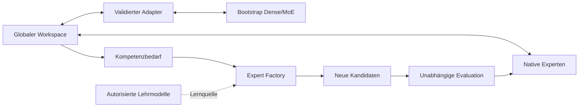
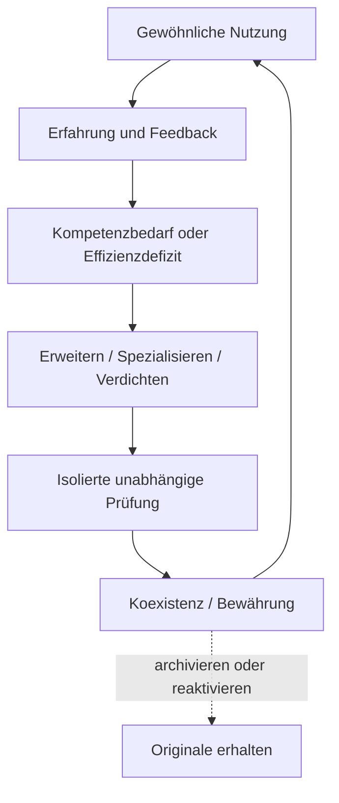

# Ergänzende Architekturentscheidungen v0.6

26.11.2026 – ergänzt die Vision v0.5 und den Review; bei Widersprüchen gelten diese neueren Zielentscheidungen. Die fünf Ziele bleiben unverändert: Environment, Basisintelligenz, Assimilation, Recherche, Neugier/Exploration. Ziel 1 ist noch nicht abgenommen.

## Heterogene Bootstrap-Population

Der Start darf vortrainierte Open-Weight-Modelle enthalten, z. B. ein schnelles Qwen-MoE in Q4, später mehrere spezialisierte Modelle. Die konkrete Modellwahl und Lizenzprüfung sind offen. Keine Gewichte mitgeliefert. Bootstrap (produktiver Teilnehmer) und externer Lehrer/Konstrukteur (explizit autorisierte Lernquelle) sind verschiedene Rollen. Ein interner MoE-Router ist innerhalb eines importierten Experten zulässig, kein zentraler kognitiver Router über die Population.

Die Textbrücke ist eine gekennzeichnete Vorstufe. Hidden-State-Ausgabe allein genügt nicht für semantisches Alignment, bidirektionale Adapter benötigen Verhaltenstests. Native Experten bleiben numerisch. Kein Anspruch auf allgemeine Intelligenz durch Modellintegration allein.

## Expert Factory und Kompetenzerwerb

Die Expert Factory soll eine begrenzte, überprüfbare Infrastruktur sein, keine steuernde Intelligenz. Anfangs erstellen externe Modelle oder Menschen Konstruktionsspezifikationen; später kann die Grundintelligenz bekannte Konstruktoren parametrisieren und kombinieren. Unterstützte Pfade: DIRECT, SYNTHESIS, PRETRAINED, TRAINED, SYMBOLIC, mit genauer Herkunft und Eltern-IDs. Klassische Destillation ist als ergänzender Weg zulässig, kein verdeckter Ersatz für direkte Konstruktion. Lehrmodelle und Materialien nur bei entsprechendem Nutzungsrecht. Modellantworten und Generatorvorschläge sind Daten, keine vertrauenswürdigen Runtime-Anweisungen. Kandidaten werden unabhängig evaluiert, Gewichte versioniert, keine unkontrollierten Änderungen an der aktiven Runtime. Autonomer Aufbau komplexer Experten nicht nachgewiesen.

## Wachstum und Verdichtung

Keine feste Grenze der Expertenzahl, Größe oder Gruppenbildung. Reguläre Expertengrößen 100–500M sind Forschungsannahmen; kleinere/größere Module nach Bedarf. Q4 als primäres Ziel für geeignete Kerne, empfindliche Köpfe und Akkumulation in höherer Präzision. 512 × 200M = 102,4B, ideal Q4 47,68 GiB; 512 × 500M = 256B, ideal Q4 119,21 GiB. Nur Gewichte. Speicher- und Rechenbudgets nach tatsächlicher Hardware; Population kann größer als resident sein. Strix Halo, Windows 11 x64, 96 GiB GPU-Budget als Ziel. Separate Studio-, Engine-, Expert- und Datenpakete; portable Distribution ohne separate Python-Installation bleibt Ziel, noch nicht erreicht.

Verdichtung kann häufige kollektive Fähigkeiten in einen kleineren Experten überführen. Nicht jedes Netzwerk ist fusionierbar. Der erste nachgewiesene Compilerfall ist rein affin: `B(Ax+a)+b = (BA)x+(Ba+b)`. Originale bleiben erhalten. Spätere Verdichtung durch Destillation oder andere Lernverfahren muss mit Holdouts, Ressourcenmessung und seltenen Kompetenzen geprüft werden.

## Abnahme der Bootstrap-Strategie

Vergleich: Bootstrap allein; Bootstrap + Environment; Environment ohne Bootstrap; Lehrer offline; später eingefrorenes vs weiterlernendes Gesamtsystem. Gleiche Aufgaben, unabhängige Holdouts, vergleichbare Budgets. Keine bloße Verschiebung der Lösungsarbeit in Encoder, Decoder, Testorakel oder externes Modell als Lernnachweis. Ein dauerhaft nicht mehr benötigter Bootstrap-Experte kann ausgelagert werden; einzigartige Kompetenzen rechtfertigen Koexistenz.

## Ergänzung vom 28.11.2026 — strukturelle Assimilation

Ziel 3 umfasst neben Behavioral und Weight-Space Assimilation nun ausdrücklich [Multi-Scale Fragment Assimilation](FRAGMENT_ASSIMILATION.md) als Forschungsweg. Unterschiedlich große vortrainierte Fragmente, lokale Wahrnehmungsköpfe, latente Adapter, freie Gruppen, additive Konsolidierung und unabhängige Selektion. Der neue Vertrag präzisiert die Abnahmekriterien, keine bereits implementierte Fragmentarchitektur.
