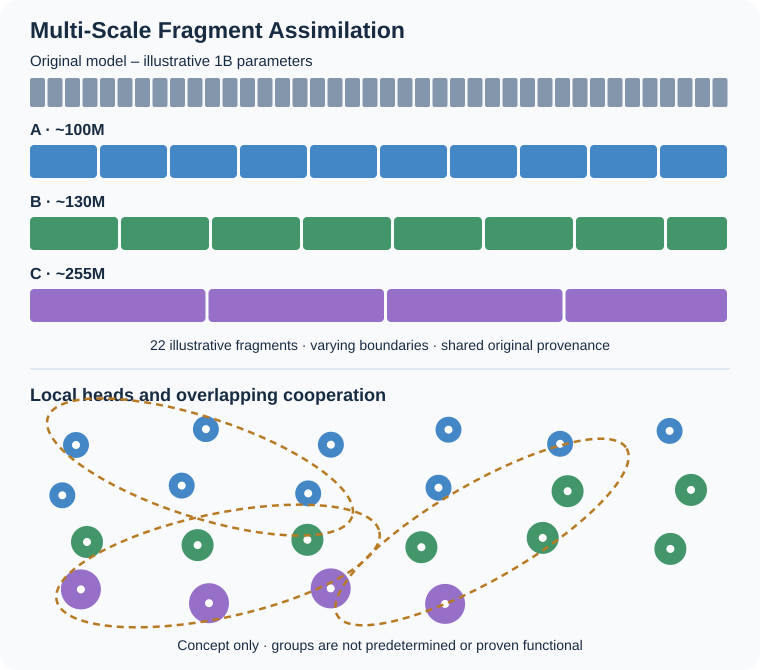
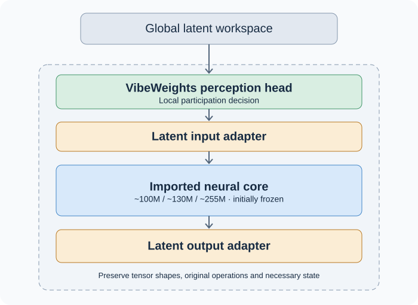

# Multi-Scale Fragment Assimilation — Forschungsziel 3

Status: verbindlich aufgenommenes **Forschungsvorhaben**, keine Implementierung der Modellzerlegung und kein Assimilationsnachweis. Ergänzt die fünf bestehenden Entwicklungsziele, insbesondere Ziel 3 (Assimilation), ohne sie zu ersetzen. Entscheidung vom 28.11.2026: neben Behavioral Assimilation und Weight-Space Assimilation einen strukturellen Importpfad untersuchen. Ausgangsidee: ein Open-Weights-Modell mehrfach zunächst blind in unterschiedlich große Stücke zerlegen, jedes ausführbare Fragment mit VibeWeights-Köpfen und Adaptern versehen, additiv aufnehmen, selbstorganisierte Kooperation erproben und unabhängig evaluieren. Mehrfache Abdeckung darf zunächst mehr Parameter beanspruchen; Effizienz wird danach gemessen, nicht erzwungen.

## Experimentelle Varianten

| Variante | Definition |
|---|---|
| A – blind | Parametergrößen als Schnittziel (z.B. 100M / 130M / 255M), ohne semantische Auswahl. Rohbyte-/Tensorschnitt als Negativkontrolle; nicht ausführbare Schnitte dokumentieren, nicht als Experten deklarieren. |
| B – strukturorientiert blind | Ganze Transformer-Blöcke und ausführbare Submodule in mehreren Größen, ggf. versetzte Startgrenzen, ohne Kompetenzanalyse. |
| C – intelligent | Aktivierungen, Abhängigkeiten, Ablation und Subnetzanalysen nutzen; ein externes starkes Modell (z.B. ChatGPT/Astra, sofern verfügbar) darf Schnittvorschläge und Auswertungen erstellen. Kein unkritisches Übernehmen seiner Kompetenzlabels. |
| D – hybrid | Mehrskalige überlappende Schnitte plus intelligent vorgeschlagene Teilnetze. |

A und B sind unterschiedliche Versuche: Ein beliebiger Bytebereich eines Safetensors-Containers ist kein ausführbarer neuronaler Graph. Operationen, Shapes, Residualpfade, Normalisierung, Attention, Positionskodierung, ggf. KV-Zustände und Abhängigkeiten erhalten bzw. explizit adaptieren. Überlappung verbessert lediglich die Chance, zusammengehörige Strukturen zu erhalten; keine Garantie. Ein späterer eigener intelligenter Schnittgenerator ist ein Forschungsziel, keine Voraussetzung für B.

Kern zunächst eingefroren. Input-/Output-Adapter müssen die interne Repräsentation mit der VibeWeights-ABI verbinden; Wahrnehmungskopf entscheidet lokal über Beteiligung. Keine globale fachliche Routerinstanz. Ursprüngliches Modell mit korrekter Architektur und Embedding-/Output-Grenzen separat als Referenz. Herkunft PRETRAINED für importierte Kerne, TRAINED oder DIRECT für jeweils entsprechende Adapter/Köpfe; kombinierte Herkunft ausdrücklich dokumentieren. Lizenz, Modellrevision, Tensorbereiche, Originalgraph, gemeinsame Speicherreferenzen, Adapterversionen und Hashes im Manifest erfassen. Erst unabhängig geprüfte Kandidaten dürfen regulär aufgenommen werden. Sicherheitsquarantäne ist getrennt von evolutionärer Selektion.

## Startmodell und Größen

Start mit kleinem offenem Modell, bevorzugt [Qwen3-0.6B-Base](https://huggingface.co/Qwen/Qwen3-0.6B-Base), alternativ [SmolLM2-360M](https://huggingface.co/HuggingFaceTB/SmolLM2-360M), später [SmolLM2-1.7B](https://huggingface.co/HuggingFaceTB/SmolLM2-1.7B). Für Qwen3-0.6B sind 6/8/16 von 28 Blöcken eine erste Annäherung an 94/126/252M Kernparameter; exakte Zahlen aus fixierter [Konfiguration](https://huggingface.co/Qwen/Qwen3-0.6B-Base/blob/main/config.json) und tatsächlichen Tensoren bestimmen. Restblöcke vollständig erfassen; Embedding und LM-Head separat behandeln, Gewichtsbindung bewahren. Drei naive vollständige Kopien eines 600M-Modells entsprechen rund 1,8B Parametern bzw. 3,6 GB BF16-Payload (dezimal); tatsächliche Fragmentüberlappung, Adapter, Cache, Training und Backend-Peaks separat messen. Immutable überlappende Tensoren können später physisch geteilt werden; experimentelle Logik darf nicht durch unerwartete Gewichtsänderungen gekoppelt werden.

## Abnahme und Falsifikation

1. Reproduktion: Originalreihenfolge mit identischen Eingaben und Zuständen gegen das eingefrorene vollständige Modell vergleichen (logits, numerische Toleranz, mehrere Sequenzlängen, deterministische Generation). Keine Reproduktionsparität behaupten, wenn Schnittgrenzen nicht exakt ausführbar sind.
2. Assimilation: Fragmente ohne externes vollständiges Modell und ohne Lehrer-/Target-Faktenabruf verwenden. Baseline mit vollständigem Original und optional mit dessen klassischem Routing. Reproduzierte Originalkette allein ist noch kein Assimilationsnachweis.
3. Selbstorganisation: unterschiedliche lokale Köpfe, offene Einladungen, Gruppen, Rekursion; Vergleich gegen feste Originalreihenfolge und zufällige Gruppen. Neue funktionsfähige Kooperationen auf unabhängigen Aufgaben messen.
4. Konsolidierung: neue Summenexperten additiv erzeugen, Eltern unverändert. Nutzen, Retention, seltene Kompetenzen, Kooperation und Kosten vergleichen; keine automatische Ablösung durch Konsolidierung.
5. Selektion: getrennte langfristige Evidenz entscheidet über Archivierung. ACTIVE und LOW_ACTIVE_IMPORTANT im VRAM, ARCHIVED auf SSD. Keine RAM-Residency-Stufe, keine evolutionäre Löschung. Initiale Redundanz ist erlaubt; Archivierung nur nach nachgewiesener entbehrlicher Kompetenz und Abhängigkeitsprüfung.
6. Neue Zusammenhänge: unabhängige Holdouts mit neuen Kombinationen, Transfer, ggf. Aufgaben, die das Originalmodell nicht löst. Gleiche Ressourcenbudgets; keine Gleichsetzung von Recall, Skalierung oder zusätzlicher Adapterkapazität mit allgemeiner Intelligenz.

Kontrollen: zufällig initialisierte Kerne gleicher Architektur/Größe; eingefrorene vs trainierte Adapter/Köpfe; Originalreihenfolge und zufällige Reihenfolge; klassische Destillation bei gleichem Rechen- und Datenbudget; Adapter-only/Ablation der Fragmente; einzelne vs mehrskalige Zerlegung; intelligent vs blind; ohne und mit weiterer Optimierung der Kerne. Getrennte Datenfamilien für Training/Evaluation; gleiche Lehrerzugänge und Budgets. Messwerte: korrekte Aufgaben, Enthaltung, Transfer, Retention, tatsächlicher marginaler Nutzen, Parameter/Bytes, Peak-VRAM, Zeit, Energie soweit messbar, Trainingsaufwand, Anzahl Kooperationen, Robustheit gegenüber Schnittgrenzen. Erfolg nicht vorwegnehmen: Falls zufällige Kerne plus Adapter gleich gut sind oder nur die Originalkette funktioniert, ist strukturelle Assimilation in diesem Versuchsaufbau nicht nachgewiesen.

## Anschluss an Forschung

Verwandte, nicht identische Ansätze: [MoEfication (2022)](https://aclanthology.org/2022.findings-acl.71/), [Emergent Modularity (2023)](https://aclanthology.org/2023.findings-acl.250/), [Emergent MoE (2024)](https://aclanthology.org/2024.naacl-long.144/), [Knowledge-Critical Subnetworks (2024)](https://aclanthology.org/2024.emnlp-main.376/), [Model Stitching (2021)](https://arxiv.org/abs/2106.07682), [Union of Experts (2025)](https://arxiv.org/abs/2503.02495). Diese Referenzen stammen aus der vorausgehenden Recherche; sie belegen keine Funktionsfähigkeit der vorgeschlagenen Kombination. Keine Behauptung weltweiter Neuheit. Die Literatur liefert Ansatzpunkte für funktionale Teilnetze und Schnittstellen, nicht den Nachweis autonomer Assimilation.

## Roadmap

A0: lokal reproduzierbarer Fragmentimport, identische Originalkette, Inventar und Lizenz/Hashes. A1: kompatible latente Adapter, erste lokale Köpfe, kleine isolierte Kerne, Kontrollversuche. A2: mehrskalige und intelligente Schnitte vergleichend testen, dynamische Kooperation. A3: Wissenstransfer und additive Konsolidierung mit unabhängigen Holdouts; A4: unabhängige Selektion, Archivierung, Wiederaktivierung, neue Zusammenhänge. Abhängigkeiten: universelles numerisch/latentes ABI, reale Gruppenarbeit, Ressourcenmessung, unabhängige Abnahme, robuste Source-/Memory-Transaktionen. Parallel zu Behavioral Assimilation (Lehrmodell) und Weight-Space Assimilation (gezielte Analyse/Synthese). Kein festes Zeit-/Erfolgsversprechen.

## Implementierungsstand A0 (dev24-Kandidat)

[Qwen3-Fragmentimport und Reproduktionsvertrag](QWEN3_FRAGMENT_A0.md): strukturorientierte Blind-Schnitte, immutable Blockartefakte, geteilte logische Mehrskalen-Sichten, separat ausführbare Spans, Referenzparität über originale Reihenfolge. Separate Tiny-Architektur- und Pretrained-CI, Ergebnisse offen. Noch keine Aufnahme regulärer Experten oder Assimilationsbehauptung.

A0-Nachweis erbracht am Codecommit b9d051921343914dc2f153e75268b0f4c7453c16: echte Qwen3-Gewichte, drei Partitionen, 15/15 exakte FP32-Logit-Vergleiche, Tiny-Tests 4/4 Windows und Linux. [Rohdaten](../evidence/v08-qwen3-fragment-a0.json). A1 bleibt eigenständige Prüfung.

## Implementierungsstand A1 (dev25-Kandidat)

[Erster Adapter-/Head-Vertrag](FRAGMENT_ADAPTER_A1.md): eingefrorener nativer Prefix plus trainierter binärer Ausgabekopf, unabhängiger lokaler Beteiligungskopf, separate Holdout-Freigabe, unveränderliche Provenienz, drei Kontrollarme (importiert / zufällige Decoder / Embedding-only). Keine universelle latente ABI, keine allgemeine Population-Aufnahme oder Assimilationsbehauptung. Ergebnisse offen.

A1 erster Vergleich: 7/12 Pretrained, 5/12 Zufall, 6/12 Embedding-only; keine Aufnahme. [Rohdaten](../evidence/v08-fragment-adapter-a1.json). A1 bleibt offen; A2 nicht als nachgewiesen behandeln.

## A1 Folgerunde dev26 (Kandidat)

[Latente Konditionierung](FRAGMENT_CONDITIONING_A1.md): vierarmiger Vergleich für Pooling/Skalierung am 6-Block-Prefix, 16-Block-Skalenpaar, gematchte Zufalls- und Embeddingkontrolle. Neue Holdouts; unveränderte Abnahmeschwelle. Keine dynamische Kooperation behauptet. Ergebnisse offen.

A1 dev26: p16-combined 16/16 disjunkte Holdouts und experimentell freigegeben, alle Zufalls-/Embedding-Kontrollen je 11/16. [Rohdaten](../evidence/v08-fragment-conditioning-a1.json). Entscheidung des Nutzers: Kompetenzen nicht vorab willkürlich zuweisen, sondern systematisch durch Aktivierungsprofile und kausale Interventionen kartieren. A1 bleibt eng begrenzt; keine allgemeine Assimilation.
