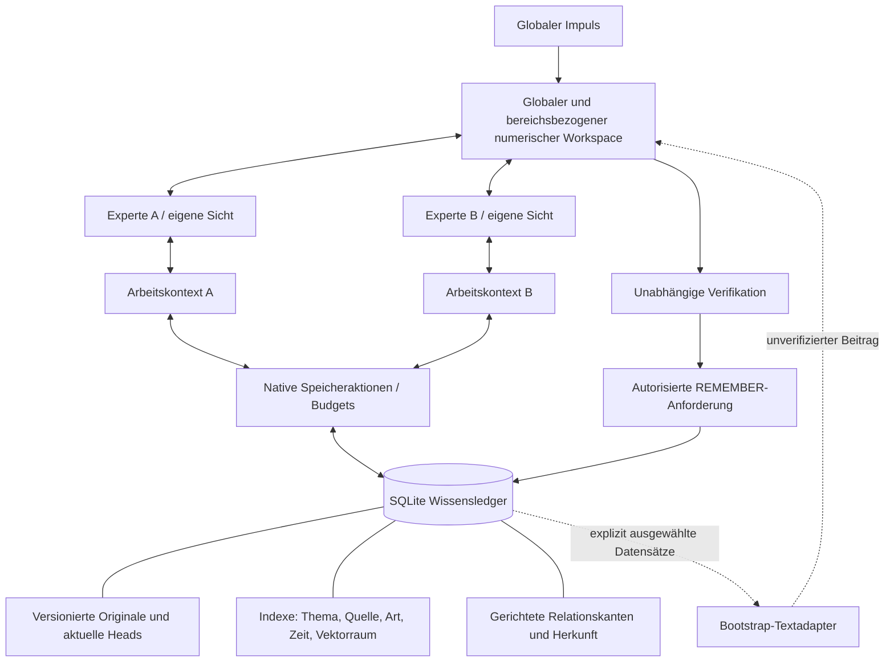

# VibeWeights – Memory Architecture v0.7.0

Status: ausführbarer Environment-Slice; noch keine Environment-Abnahme. Dieser Vertrag konkretisiert `ARCHITEKTUR_v06.md` und den bisherigen `memory_contract.md`. Die ursprünglichen fünf Entwicklungsziele, dezentrale Organisation, variable Expertengrößen, Q4-Ziel, Bootstrap-Assimilation und Windows-Portable-Ziel bleiben unverändert.

## Motivation

Wissen, Erfahrung, Kompetenzgewichte und aktive Rechenzeit sollen unabhängig wachsen können. Ein Expertensystem darf nicht bei jeder Anfrage seine gesamte Vergangenheit in ein Textfenster laden. Es soll passende Erinnerungen finden, referenzieren, verarbeiten, überprüfen und wieder freigeben. Langfristig soll es auch die Indexe, Beziehungen, Verdichtungen und Lernziele eigenständig verwalten. Ein Index ist keine Wahrheitsinstanz; Nutzerzufriedenheit, Evidenz und verifizierte Kompetenz bleiben getrennt.



Das Diagramm zeigt die implementierten Ledger-/Kontextmechanismen und die vorgesehene Anbindung des Bootstrap-Beitrags. Der Textadapter ist separat aufrufbar; seine Antwort wird noch nicht automatisch in den numerischen Workspace integriert. Die bisherige Chat-/API-Anwendung benutzt weiterhin den älteren arithmetischen Pfad.

## Speichervertrag (knowledge-v1)

| Komponente | Implementiert |
|---|---|
| `KnowledgeLedger` | SQLite; logische Schlüssel `(scope,key)`, unveränderliche Versionszeilen und atomarer Head-Wechsel |
| `Record` | ID, Scope, Schlüssel, Revision, Topic, Typ, Status, numerischer Payload, Quelle, vorherige Revision, Eltern-IDs, optionaler Embeddingraum/Vektor, Zeitstempel |
| `Access` | Globale Sicht, eigener `private:<expert>`-Bereich, explizit zugewiesene `group:<id>`-Bereiche |
| `WorkingContext` | Eigene Trefferlisten und geladene Records pro Experteninstanz und Run |
| `ContextLimits` | Speicheraktionen, Treffer pro Experte, geladene Records/Komponenten pro Experte und über alle Experten, maximale Kandidatenzahl der Vektorsuche |
| `Environment.run(..., knowledge=..., access=...)` | Opt-in-Verknüpfung des neuen numerischen Kerns mit dem Ledger |

Die Typen `semantic`, `episodic`, `procedural`, `cooperation`, `reflection`, `hypothesis` sind Speicherkategorien, keine nachgewiesenen kognitiven Fähigkeiten. Status `OBSERVED`, `HYPOTHESIS`, `VERIFIED` stammt aus einer vertrauenswürdigen Host-Policy bzw. bei REMEMBER aus dem unabhängigen Verifikationspfad. Er wird nicht aus einem Confidence-Wert oder Modelltext abgeleitet. Unverifizierte Einträge sind für Host-Analyse zugänglich; Standard-Suche und native READ-Aktion verwenden nur verifizierte Erkenntnisse.

`store` erzeugt einen neuen Schlüssel oder eine Revision mit genau der erwarteten aktuellen Record-ID (Compare-and-swap unter `BEGIN IMMEDIATE`). Falsche oder veraltete ID: Fehler, keine Überschreibung. Standardabfragen berücksichtigen aktuelle Heads; explizite historische Reads sind möglich. Eine unverifizierte neuere Revision verdeckt den alten Head im Standardabruf; kein stiller Fallback auf veraltete Aussagen. Eltern- und Vorgängerreferenzen bleiben erhalten. Die Relationstabelle verweist auf konkrete Versionen. Bestehende alte Datenbanken werden nicht automatisch migriert; `Data/knowledge_ledger.sqlite` ist ein neues Schema. Keine alten Nutzerdaten werden im Release mitgeliefert.

## Indexe und ihre Grenzen

- Exakte SQLite-Indexe: Schlüssel/Revision, Topic/Typ/Status, Quellen-ID, Zeit, Embeddingraum; gerichtete Relationen mit Vorwärts-/Rückwärtsindex.
- `search` filtert nach Sichtbarkeit, aktuellem Head und optional Topic, Typ, Quelle, Status und Zeitintervall.
- Vektorsuche: explizit bereitgestellte, normalisierte Vektoren im selben versionierten Raum und mit derselben Dimension; exakte Cosine-Rangfolge, stabile ID bei Gleichstand. Kandidatengrenze wird nicht still abgeschnitten. Kein ANN/HNSW, kein automatisch gelernter semantischer Encoder und keine Garantie, dass ähnliche Vektoren semantisch richtig sind.
- `link`/`related`: gerichtete, versionierte Referenzen; keine automatisch extrahierten Relationen, keine allgemeine Kausalitäts- oder Transitivitätsmaschine. Native RELATED gibt IDs zurück; READ prüft Status und Sichtbarkeit separat.
- `store` mit Elternreferenzen ermöglicht nachvollziehbare Konsolidierungskandidaten; autonome Abstraktion, Kompression, Konfliktauflösung und Reindexierung sind noch offen. Originale bleiben unverändert.

## Native Speicheraktionen

| Code | Aktion | Vertrag |
|---:|---|---|
| 1 | SEARCH | Topic-/optionale Vektorsuche, Treffer-IDs in eigener View; keine automatische Ladung aller Inhalte |
| 2 | READ | Explizite ID lesen, nur verifizierte und sichtbare Revisionen |
| 3 | EVICT | Record aus eigener aktiver View entfernen; persistente Kopie bleibt |
| 4 | RELATED | Ziel-IDs einer benannten Relation abrufen |
| 5 | REMEMBER | Nur opt-in autorisierter Experte, der den bereits verifizierten Zielwert selbst vorgeschlagen hat; keine frei formulierten Schreibdaten |

Expertenadapter bieten `memory_action(snapshot,view)` und `forward_with_memory(snapshot,view)` an. Die technische Runtime führt maximal eine Aktion je relevantem Experten und Runde aus; eine Aktion verbraucht eine separate Speicheraktionsquote. Nach Änderung des Arbeitskontexts darf die Berechnung erneut laufen. Unveränderte Zustände führen zur Stagnation, harte Runden- und Aufrufgrenzen bleiben bestehen. Der Prototyp verwendet numerische Action-Enums und typisierte IDs; Topic- und Scope-Namen sind ABI-Metadaten, keine natürlichen Sprachdialoge.

REMEMBER wird vorgemerkt. Nur ein erfolgreicher, konvergierter Run schreibt seinen exakten verifizierten Zielwert als neuen Record mit `result:<run_id>` und Quelle `run:<run_id>`. Eltern sind konservativ die bei den betreffenden Vorschlägen geladenen Record-Revisionen. Kein automatischer Rewrite vorhandener Fakten, keine Speicherung beliebiger Modellbehauptungen. Der Host erteilt die Berechtigung (`remember_experts`); ein nicht berechtigter Adapter kann keine Speicherung anfordern. Speicherfehler erscheinen separat als `memory_commit_error`. Die Journal- und Wissensdatenbank sind noch keine gemeinsame Transaktion: Crash-Recovery über die beiden DB-Grenzen bleibt offen. Herkunft ist bisher keine vollständige transitive Provenienz über alle Zwischenexperten.

## Sichtbarkeit und Ressourcen

Mit aktiviertem Ledger filtert der neue Workspace `private:` und `group:`-Scopes für jeden Experten; übrige freie Scope-Namen behalten die globale v0.6-Semantik. Private und gruppenbezogene Record-Reads benötigen die passende Sicht. Direkt geladene Quellen dürfen nicht in einen weiteren Scope publiziert oder als Eltern eines breiter sichtbaren Records gespeichert werden. Die Host-Validatoren sehen den gesamten Run. Die Zugriffsregeln sind **logische Grenzen für vertrauenswürdige Python-Adapter**; keine Prozess-/Mandantenisolation, keine vollständige transitive Informationsflusskontrolle, keine Geheimhaltung gegen beliebigen Python-Code. Gruppenberechtigungen werden im Slice vom Host vorgegeben, noch nicht autonom ausgehandelt.

Limits zählen logische Einträge und Komponenten, keine tatsächlichen Bytes/FLOPs. Views und Snapshots bleiben teilweise in der Laufhistorie für Signatur-/Stagnationsprüfungen; daher garantiert EVICT keine sofortige physische RAM-Freigabe. Trefferlisten sind pro Experte begrenzt, noch kein globales Bytebudget für alle Treffer, Spuren, Hypothesen und Vektorsuchpuffer. Die exakte Vektorsuche ist für kleine kontrollierte Datenbestände vorgesehen. Für große Datenmengen sind Streaming, ANN, Cache und echte Speicherlimits erforderlich.

## Nachweis: Erinnern – Rechnen – Speichern – Wiederverwenden

```sh
python -m vibeweights.next memory-demo 7 --initialize --remember
python -m vibeweights.next memory-demo -7
```

Das Demo initialisiert einen verifizierten Offset 6 und einen Ablenkungsdatensatz 91. Der Eingabezustand enthält nur x. Ein analytisch erzeugter 3×3-Identitätskopf (9 Parameter, zur Laufzeit konstruiert) wählt SEARCH/READ/READY anhand eines expliziten Statusvektors. Der Topic-Schlüssel ist für diese Kompetenz festgelegt; REMEMBER/EVICT nach verifiziertem Ergebnis sind symbolische Referenzentscheidungen. Die affine Addition verwendet separat persistierte echte SafeTensors-Gewichte (3 Parameter) der Factory. Ein unabhängiges, auf diese Fixture begrenztes Host-Orakel akzeptiert nur x+6. Mit x=7 entsteht 13. REMEMBER speichert den verifizierten Wert und die ursprüngliche Quellen-ID; EVICT entfernt nur die aktive Kopie. Ein weiterer Test öffnet die DB erneut, sucht unter 1.000 zusätzlichen Ablenkungsdatensätzen den gespeicherten Wert 13 und lässt einen zweiten neuronalen Experten 26 berechnen. Die Selektionslogik des Folgeexperten ist symbolisch. Null-Training; kein Nachweis allgemeinen Lernens oder autonomer Kompetenzerzeugung.

Die Mutation des Aktionskopfes verhindert den Abruf. Der Test ohne initialisierte Datenbank kann kein Ergebnis freigeben. Revisionen, konkurrierende Schreiber, unzulässige Sichtbarkeit, Vektorräume und Budgets sind durch zusätzliche Tests abgesichert. Die Testfälle sind vom Entwicklungssystem autorisiert und keine unabhängige externe Replikation.

## Bootstrap-Kontext

`BootstrapExpert.propose_with_context(text,ledger,access,record_ids,max_chars=...)` serialisiert explizit ausgewählte verifizierte numerische Datensätze samt Version und Quelle. Identität, Sichtbarkeit und Zeichengrenze werden vor Transport geprüft. Keine automatische Vollhistorie, kein versteckter externer Zugriff, kein Tokenbudget-Schätzer. Die bestehende Loopback-Textbrücke bleibt unverändert; echte Qwen-Inferenz, semantische Adapter und autonomer LLM-Abruf sind offen. Ausgaben bleiben `verified=false`. Der neue Kontextadapter wurde mit einem Transport-Double geprüft, bestehender HTTP-Transport mit lokalem Testserver.

## Forschungsbezug und weitere Entwicklung

Die bisherige Literaturübersicht (`FORSCHUNG_2026-11-26.md`, `FORSCHUNG_ERGAENZUNG_v05.md`) bleibt Bestandteil der Projektdokumentation. Besonders einschlägig sind Shared Global Workspace (https://arxiv.org/abs/2103.01197), MemGPT (https://arxiv.org/abs/2310.08560), Self-RAG (https://arxiv.org/abs/2310.10700) und die dort dokumentierte Transactive-Memory-Forschung. Sie motivieren begrenzte aktive Zustände, selektiven Abruf und verteiltes Kooperationswissen; keine dieser Arbeiten ist ein Nachweis unserer gesamten Architektur. Für v0.7 wurde keine neue Literaturrecherche oder Replikation durchgeführt.

Prioritäten: neuer regulärer Chat-Pfad und Migration, generischer semantischer Encoder/ABI, eigene private Rekursion und dynamische Scope-Gruppen, Wissenskonflikte mit Evidenz, Feedbackreflexion, indexierte Erfahrungs-/Kooperationsdaten, autonome Konsolidierung, sichere persistente Lernjobs, reale Bootstrap-Integration und anschließend unabhängiger Kompetenzerwerbsnachweis. Q4/GGUF, native CPU/GPU-Engine, Studio und Windows Portable bleiben separate Environment-Arbeitspakete.
