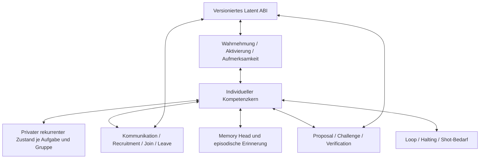
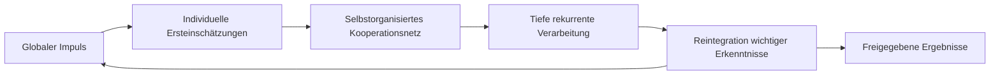
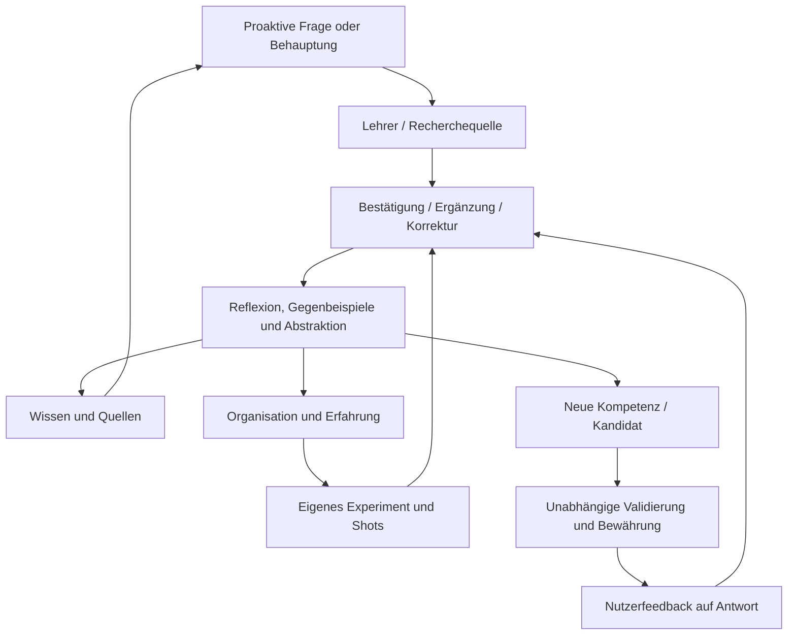

# VibeWeights — Vision, Motivation und verbindliche Zielarchitektur

Stand 26.11.2026 · Konsolidierung aller Architekturentscheidungen bis v0.5.0. Dieses Dokument beschreibt das **Ziel**, nicht den vollständigen Ist-Zustand. Für implementierte Details siehe [platform_v05](platform_v05.md). Es hat Vorrang vor früheren Router-orientierten Zielbildern. Ursprünglicher Auftrag und historische Entscheidungen bleiben nachvollziehbar erhalten.

## 1. Ursprung und Motivation

Die Idee entstand aus lokaler KI, Looped Models, MoE, effizientem Training, latentem Reasoning und indexierter Kontextverwaltung. Statt einer monolithischen Sprachmodellarchitektur soll ein neuronales Ökosystem aus unabhängig entwickelten Kompetenzen entstehen. Das System soll nicht nur Antworten erzeugen, sondern in seiner Zusammensetzung und in seinem Wissen langfristig veränderlich sein. VibeWeights ist von anderen lokalen Inferenzprojekten unabhängig.

**Hypothese:** Intelligenz könnte durch die Organisation unabhängig erzeugter Kompetenzen, wiederverwendbare Erfahrungen, dynamische Denktiefe und kontinuierlichen Kompetenzerwerb skalieren. Das ist keine bereits bewiesene Eigenschaft und kein AGI-Anspruch. Wir trennen sechs Ressourcen: Gewichte (Kompetenz), indexierte Fakten (Wissen), Episoden (Erfahrung), Kooperationsgraph (Organisation), Rechenzeit (Denktiefe), Kandidatensynthese (Entwicklung). Jede Verbesserung muss unabhängig messbar sein.

## 2. Übergeordnete Entwicklungsziele

| Ziel | Motivation | Nachweis / Exit-Kriterium |
|---|---|---|
| 1 Environment | Erst die Plattform stabilisieren, bevor viele Experten entstehen | Beliebige kompatible Module integrierbar; dynamische Aktivierung, Gruppen, Loops, Speicher, Telemetrie, Feedback, Varianten, Sprache und Ressourcen durch Produktionspfad getestet |
| 2 Basisintelligenz zur Assimilation | Nicht alle Fähigkeiten manuell entwickeln; Bootstrap für Lernen | Erstmals unbekannte formal definierte Kompetenz mit zugelassenem Lehrer erwerben, auf Holdouts ohne Lehrer anwenden; Herkunft klar |
| 3 Lernen durch Assimilation | Vorhandene Modelle als zeitweilige Lehrer, keine permanente Abhängigkeit | Dauerhafter Kompetenzzuwachs über mehrere Aufgabenklassen; Kosten, Transfer und unabhängige Generalisierung messen |
| 4 Lernen durch Recherche | Zunehmende Unabhängigkeit von Lehrmodellen | Nachvollziehbare Quellen, Gegenbelege und selbstständig erworbene neue Fähigkeiten |
| 5 Neugier und Exploration | Lernziele auch ohne Nutzerauftrag selbst entdecken | Innerhalb freigegebener Ressourcen Lernfragen und Experimente initiieren, nachweislich nützliche Ergebnisse erzeugen |

Die Ziele können sich nach dem Bootstrap gegenseitig verstärken. Kein Übergang aufgrund einer bloßen Architekturzeichnung; Abnahme durch Verhalten. Die Infrastruktur für alle Ziele soll früh vorgesehen werden, die kognitiven Fähigkeiten müssen einzeln entstehen.

## 3. Architekturprinzipien und Motivation

| Prinzip | Warum | Grenze / Prüfpflicht |
|---|---|---|
| Kein zentraler kognitiver Router | Kein vorab bestimmter Denkpfad oder hierarchischer Planer | Scheduler darf nur technische Ressourcen und Zustellung entscheiden |
| Standardisiertes Expertenmodul | Austausch und Wachstum ohne Gesamttraining | Gleiche Tensorform garantiert keine semantische Übereinstimmung |
| Globale Wahrnehmung, lokale Vertiefung | Breite Assoziation ohne alle Kompetenzgewichte zu rechnen | Recall relevanter Köpfe und Bandbreite messen |
| Arbeitsgruppen als emergentes Verhalten | Keine künstliche kognitive Grenze | Überlappung, variable Größe, Teilung, Fusion, auch Einzel-/Gesamtnetzverarbeitung |
| Rekursion ohne Tokenbindung | Denkaufwand flexibel an Aufgabe anpassen | Fortschritt, Zyklenerkennung, harte physische Budgets |
| Individuelles Kooperationsgedächtnis | Wissen, wer bei welcher Aufgabe hilfreich war | Kaltstart, negative Erfahrungen, veraltete Varianten, keine Beliebtheitsspirale |
| Exploration Shots | Unbekannte Kooperationen zufällig erproben | Zufall reproduzierbar; nützliche Wirkung statt bloßer Teilnahme |
| Feedback und Reflexion | Von echten Nutzungserfahrungen lernen | Zufriedenheit ≠ Wahrheit, falsches Feedback nicht als Fakt übernehmen |
| Evolutionäre Varianten | Verbesserung ohne erzwungenen Versionswechsel | Faire Vergleiche, Quarantäne, Versionen, unabhängige Freigabe und Rückrollbarkeit |
| Latente Kommunikation | Kein sprachliches Prompt-Pingpong; freie interne Architekturen | Semantik, Gültigkeitsmasken, Provenienz und ABI-Versionen prüfen |
| Eigene Sprachmodule | Denken unabhängig von Token-/Satzproduktion | Decoder darf nicht versteckt die Aufgabe lösen |
| Native Speicheraktionen | Wissen über den aktiven Kontext hinaus selbst verwalten | Versionen, Quellen, widersprüchliche Fakten, Budgets und Eviction |

## 4. Universelles Expertenmodul

Standardisiert werden Vertrag, Ereignisse, numerische Bedeutung, Zustands- und Ressourcenregeln; nicht der innere Aufbau. MLP, rekurrente Schaltung, assoziativer Speicher, Transformer, SSM etc. sind Kandidaten. Köpfe dürfen zunächst symbolische Referenzen sein, aber nur nachgewiesene neuronale Pfade als solche ausweisen. Module technisch inventarisieren (ID, Version, Hash, ABI, Speicherbedarf, Elternvarianten, Herkunft und Tests); daraus entsteht keine fachliche Gruppenhierarchie. Jeder Experte kann mehrere Fähigkeiten besitzen, neue entdecken und sich spezialisieren. Die frühere 512er Taxonomie ist eine unverbindliche Orientierung, kein vorgeschriebener Kompetenzbaum.

## 5. Global → Detail → global

Jeder Experte soll relevante globale Impulse wahrnehmen können. Drei Rechenstufen: leichter Wahrnehmungskopf, Orientierung mit Erinnerungsabruf und Kooperationsangebot, tiefer Kompetenz-Forward. Globale Daten werden einmal veröffentlicht, Referenzen statt Kopien zugestellt. Reichweite privat, direkt, lokal, regional oder global. Arbeitsgruppen sind optionale, temporäre und überlappende Strukturen; eine Anfrage kann 1, 8, 50 oder mehr Experten involvieren. Kein Top-K je Anfrage, Runde oder Ausgabetoken; physische Budgets, Queue-Limits und Laufzeitgrenzen bleiben zwingend. Globale erneute Wahrnehmung ist auch während eines lokalen Loops oder der Ausgabe möglich. Gruppen werden nicht dauerhaft registriert, sondern entstehen aus Bedarf, Einladung und Beitrittsentscheidungen. Die Runtime darf im Notfall unterbrechen, aber keine fachliche Gruppe erzwingen.

Vier Loop-Ebenen: privater Eigenloop, Gruppenloop, gruppenübergreifende Rekursion, globaler Reflexionsloop. Stabilität ist kein Wahrheitsbeweis; auch falsche Zustände können konvergieren. Abbruch bei nachgewiesener Freigabe, Stagnation, Konflikt, Budget oder Nutzerabbruch unterscheiden.

## 6. ABI, Ereignisse und Gedächtnis

Semantische Grundschicht: Entitäten, Relationen, numerische Werte, Ziele, Hypothesen, Evidenz, Status, Revision, Gültigkeitsmasken und stabile IDs; optional dichte Tensorrepräsentationen mit versioniertem Adaptervertrag. Unbekannt, falsch und nicht anwendbar sind getrennt. Keine willkürliche Mittelwertbildung inkompatibler latenter Zustände. Private Netzzustände können andere Dimensionen haben. Technische Strings (IDs, Manifeste, Logs) sind keine sprachliche Reasoning-Kommunikation.

Zielereignisse: NEED, OFFER, INVITE, JOIN, LEAVE, FORK, MERGE, PROPOSE, SUPPORT, CHALLENGE, VERIFY, LOOP, SHOT, MEMORY_REQUEST/RESULT, READY, HALT, FEEDBACK, REFLECT. Jedes mit Kausalreferenz, Quell-/Ziel-ID, Scope, Revision und validiertem Payload. Ein technischer Eventbus darf weder den Inhalt der Beiträge bestimmen noch Experten nach einem zentralen Relevanzscore auswählen. Abonnements und Wiederverwendung reiner Kopfentscheidungen reduzieren Kosten; offene globale Discovery bleibt möglich.

Speicherhierarchie: private Arbeitszustände, lokaler Gruppenworkspace, globaler Workspace, indexiertes persistentes Wissen. Individuelle Episoden und transaktives Gedächtnis (wer kann was, wann half es?) werden getrennt von Fakten und Gewichten geführt. SEARCH, READ, WRITE, UPDATE, LINK, COMPRESS, EVICT werden durch numerische Anforderungen ausgelöst und von der Runtime überprüft. Originalquellen bleiben erhalten; Hypothesen, Korrekturen und bestätigte Fakten unterscheiden. Provenienz, Versionskonflikte, Session-Isolation, Freigabe, Datenminimierung und Löschkonzept berücksichtigen.

## 7. Ausgabe ohne Tokenbindung

Input-Encoder bildet die Aufgabe ab und löst sie nicht. Output-Decoder erhält freigegebene semantische Ergebniseinheiten; Token, Satz, Absatz, Block oder strukturierte Ausgabe sind mögliche äußere Formate. Denken und Sprachgenerierung können asynchron laufen. Ein Output-Experte darf Klärungsbedarf anmelden und weitere Experten rekrutieren. Bereits freigegebene Aussagen benötigen explizite Revision, wenn neue Erkenntnisse ihnen widersprechen. Eine vorläufige Aussage ist als solche gekennzeichnet. Aktuell nur begrenzte Grammatik und Ergebnis-Verbalizer.

## 8. Exploration und Messung

Random Shots, Cold Shots für seltene/neue Varianten, Diversity Shots, Stagnation Shots, Challenge Shots und alternative Gruppenkonstellationen. Zufall öffnet Möglichkeiten; Qualität entscheidet über Konsolidierung. Inferenzbudget niemals unkontrolliert ausweiten. Seed und Samplingbedingungen protokollieren. Erkundung darf nicht durch feste Gruppengröße beschränkt werden und muss auch bisher unbekannte Experten zulassen. Exploration kann bei bekannten Aufgaben gering und bei Stagnation oder Widerspruch höher sein; dies bleibt experimentell. Zunächst getrennte Shadow-Probes, später echte Beiträge mit Evidenzvertrag.

Metriken pro Expertenidentität (Version, Gewichtshash und Köpfe), Kontext und Episode: Gelegenheiten, Aktivierungen nach Ursprung (selbst / Einladung / Shot), Angebote, Beitritte, tatsächliche Beiträge, Rekursion, Einladungsnachfrage, Kooperationsdiversität, verifizierte Beiträge, Korrekturen, Nutzerzufriedenheit, Kosten, einzigartige Kompetenzabdeckung, kausaler Grenznutzen. Erfolge nicht pauschal auf alle Teilnehmer verteilen. Vergleich mit/ohne Beitrag bei identischer Aufgabe, Saat, Budget und möglichst gleicher Ausgangssituation. Nicht aus Aktivierungshäufigkeit allein auf Intelligenz schließen. Negative und seltene Ergebnisse erfassen; unabhängige Holdouts nicht als Synthesesignal verwenden.

## 9. Drei Lernwege

**A Proaktives Lernen:** jeder Experte kann eine Frage oder eine Aussage, die er für wahr hält, zur Prüfung anbieten. Antwort bestätigt, ergänzt oder korrigiert. Behauptung mit Gegenbeispielen und unabhängigen Quellen prüfen; Bestätigung ist nicht automatisch Wahrheit. Ergebnisse als Fakt, Relation, Methode, offene Frage oder neuer Kompetenzbedarf klassifizieren.

**B Nutzerfeedback:** Antwort V1 → Zufriedenheit/Korrektur/Präferenz → Reflexionsgruppe (ursprüngliche + neue Experten) → Recherche und neue Antwort V2 → erneutes Feedback. Wiederholen innerhalb expliziter Budgets. Jede Antwortversion und ihre tatsächlichen Beiträge verknüpfen. Positive Information konsolidieren, sachliche Prüfung von Zufriedenheit getrennt. Negative Bewertung kann einen Fehler in Input, Decoder, Fakten oder Reasoning betreffen. Nicht automatisch alle Experten abwerten.

**C Eigenexperimente:** neue Kooperationen, Hypothesen, Gegenbeispiele und Varianten erproben; unabhängig bewerten. Modi Inference, Reflection, Learning; Lernbetrieb nur bei vom Nutzer freigegebenen Zeit-, Speicher-, Rechen- und Zugriffsbudgets, stoppbar und ohne selbst erweiterte Berechtigungen. Keine externen Zugriffe oder Lehrmodellgespräche ohne passende Freigaben.

## 10. Assimilation, Gewichtsprogrammierung und Bootstrap

Vorhandene Modelle können Lehrer sein, nicht versteckte produktive Denker. Gezielte Fragen, Überprüfung von Behauptungen, Rückfragen, Gegenbeispiele, Abstraktion, Synthese. Vier getrennte Übertragungsformen: (1) Wissensassimilation in Memory, (2) Methodenassimilation als Regeln/Algorithmen, (3) analytische/prozedurale Gewichtskonstruktion, (4) optionale explizite Destillation/Training. Letzteres ist kein DIRECT-VibeWeights-Nachweis. Lehrer nur lokal oder vertraglich zur Nutzung/Destillation zugelassen; Lizenzen und Herkunft dokumentieren; keine Extraktion unzugänglicher Modellgewichte. Lehrer muss bei nachfolgender Evaluation entfernbar sein.

Anfängliche Grundkompetenzen: Sprache, Logik, mathematische Abstraktion, Programmierung, Frageformulierung, Metakognition, Verifikation und Expertensynthese. Direkte analytische Gewichtsgeneratoren statt Milliarden Zahlen als Text. Herkunftsklassen DIRECT (keine Optimierung auf Beispielen), SYNTHESIS (testgesteuert), PRETRAINED, TRAINED, SYMBOLIC. Keine falsche Gleichsetzung. Die Schwierigkeit ist nicht die nominelle Parameterzahl, sondern die Semantik und Generalisierung. Ein negatives Ergebnis bleibt Forschungsergebnis.

## 11. Evolution und selbstskalierende Population

V1 bleibt unverändert. Feedback kann die Entwicklung von V2, V2a, V2b usw. auslösen. Varianten werden zunächst isoliert geprüft und anschließend nur nach unabhängiger Freigabe gemeinsam in der Population erprobt. V2 kann V1 durch tatsächlich höhere Nachfrage verdrängen; beide können sich spezialisieren oder V1 bleibt überlegen. Nachfrage ist Ergebnis, nicht alleinige Selektionsregel. Neuankömmlinge brauchen faire Exposition, bekannte Varianten können sonst aufgrund historischer Popularität dominieren. Phasen STAGED / EXPERIMENTAL / ACTIVE / SPECIALIZED / DORMANT / ARCHIVED / QUARANTINED. Ruhende Experten bleiben reaktivierbar; kein automatisches Löschen allein wegen geringer Häufigkeit. Gewichte, Eltern, Testevidenz und Rollback erhalten.

Evolution auf mehreren Ebenen: Kompetenzgewichte, Expertenvarianten, Kooperationskanten, wiederkehrende Gruppen, Lösungsprozesse und Gesamtpopulation. Eine erfolgreiche Gruppe kann selbst als kollektive Kompetenz katalogisiert und perspektivisch in einen neuen Experten destilliert werden. Dieser muss sich gegen die ursprüngliche Gruppe bewähren. Zufällige Strukturen sollen Fähigkeiten entdecken, nicht ohne Validierung produktive Änderungen erzwingen. Technische Sicherheits- und Evaluationsgrenzen bleiben außerhalb der eigenmächtigen Veränderung der Population.

## 12. Hardware, Forschungsprogramm und offene Risiken

Zielgröße zunächst ca. 512 × 100M = 51,2B Parameter, Erweiterung/Archivierung nach tatsächlicher Kompetenz. Idealer Gewichtsspeicher FP32 190,73 GiB, BF16 95,37 GiB, INT8 47,68 GiB, INT4 23,84 GiB; Overhead, KV, Aktivierungen und Transfers kommen hinzu. AMD Strix Halo 96 GiB GPU-Speicher unter Windows als Zielsystem; CPU-Referenz und Linux/Windows-CI zuerst. Kleine Köpfe resident, große Kerne cachebar und bedarfsweise geladen. Benchmark: Kosten der globalen Wahrnehmung, Recall, aktive Experten pro Zeit, Loops, Kommunikation, Speicher und Latenz, nicht nur Parameterzahl.

Hauptrisiken: ABI-Semantik; Bootstrap einer tatsächlich lernfähigen Grundintelligenz; Übersetzung von Methoden in Gewichte; kombinatorische Kommunikation; Feedback-Bias und falsche Quellen; Verifikationsgrenzen; Kosten-/Qualitätsrelation; Popularitäts- und Goodhart-Effekte; Stagnation trotz vieler Loops. Vergleich statischer Gruppen, zentraler Router-Baseline, dezentrale Organisation, Erinnerung an/aus, Shots an/aus, gepaarte Varianten, gleiche Rechenbudgets. Kleine vollständige Funktionsketten statt hunderter leerer Experten. Forschungsbezüge siehe [Literaturübersicht](FORSCHUNG_2026-11-26.md) und [Ergänzung](FORSCHUNG_ERGAENZUNG_v05.md). Die Kombination ist plausibel eigenständig, aber weder eine vollständige Neuheitsprüfung noch eine Replikation bestehender Arbeiten liegt vor.
