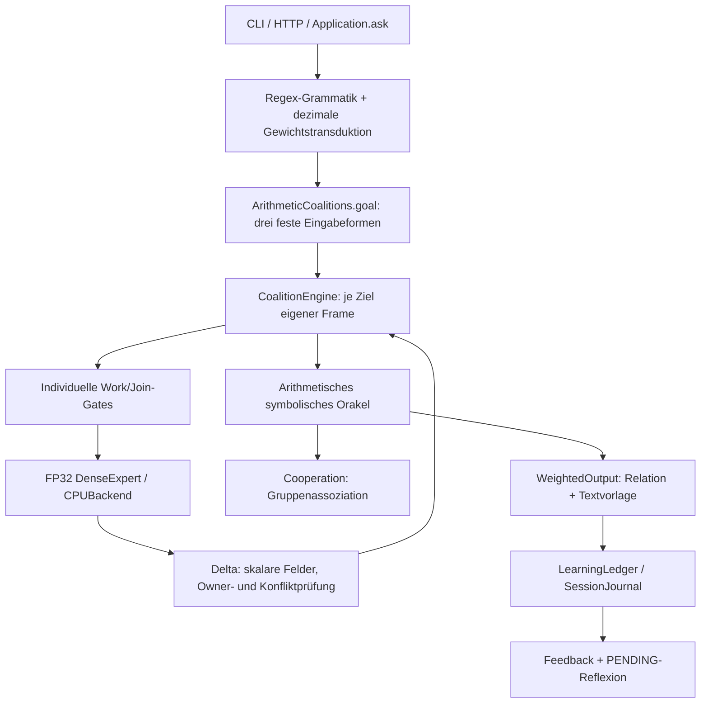
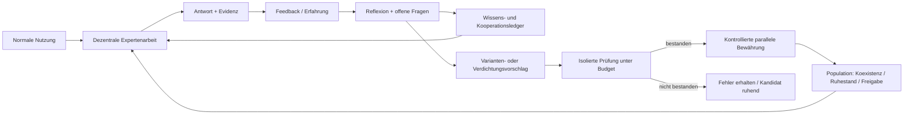

# VibeWeights – Implementierungsreview v0.5.0 und verbindlicher Entwicklungsplan (Entwurf)

Stand: 26.11.2026 · Basis: unverändertes GitHub-Startpaket v0.5.0. Dieses Dokument ergänzt die Architekturentscheidungen seit v0.5.0. Es ist kein neuer Release und kein Nachweis bereits vorhandener allgemeiner Intelligenz.

## 1. Urteil und Prüfungsumfang

- **PASS für den eng definierten arithmetischen CPU-Forschungsprototyp** und dessen reproduzierbaren lokalen Testlauf.
- **FAIL für die Abnahme von Ziel 1 (Environment)**: freie semantische Topologie, lebenslange Persistenz im Standardbetrieb, fair konkurrierende Varianten, kausale Attribution, produktive Lernzyklen, Quantisierung und portable Runtime fehlen oder sind nur teilweise realisiert.
- Kein Nachweis der Ziele 2–5. Keine Behauptung, dass bloßes Vorhandensein der Architektur allgemeine Intelligenz hervorbringt oder die Nutzung automatisch monoton zu besserer Leistung führt.

Prüfgrundlage: Original-ZIP extrahiert nach `<temp>/vwreview`, Codepfad und Architektur-/Statusdokumente direkt gelesen, alle 104 SHA-256-Einträge des Paketmanifests geprüft (keine Abweichung), Tests selbst ausgeführt. Python 3.13.5, torch 2.10.0+cpu, safetensors 0.7.0, pytest 9.0.2. Erster Lauf ohne Installation: 70 bestanden, zwei CLI-Tests fehlgeschlagen (Modul nicht auf Subprozess-Suchpfad), 10,47 s. Nach `python -m pip install -e . --no-deps --no-build-isolation`: 72 bestanden, 0 fehlgeschlagen, 0 übersprungen in 12,66 s. Neue Charakterisierungstests: 10 bestanden in 4,01 s. Das heißt, die zehn beobachteten Einschränkungen sind reproduziert, **nicht** zehn weitere erfüllte Zielanforderungen. Keine Codeänderung an v0.5.0. Kein neuer GitHub- oder Windows-/GPU-Test; keine neue Literaturrecherche oder Hardwaremessung.

## 2. Tatsächlicher Standardpfad



Der alte TaskRouter wird im normalen Application-Pfad nicht aufgerufen. Das ist ein echter Fortschritt. `coalition_arithmetic.py` besitzt aber eine feste `SCHEMA`, `HEADS`, eine manuelle Feature-Abbildung aus Feldgültigkeiten, spezialisierte Adapter und drei konkrete Boundary-Eingabeformen. Das System hat keine autonom erzeugten Teilziele, keine freie Verknüpfung zwischen Gruppen, keine konkurrierenden Hypothesen und keine allgemein sprachfähige Kodierung. `run_groups` interleaved isolierte, extern gelieferte Ziele; es ist keine physisch parallele Ausführung und keine selbstständig gebildete Gruppenhierarchie. `Op` enthält Ereignistypen, aber Ereignisse sind primär Protokollierung innerhalb einer Schleife; kein generischer abonnierbarer Bus mit frei typisierten Payloads.

## 3. Reviewbefunde und Prioritäten

| ID | Schwere für Zielarchitektur | Codebezug / reproduzierter Befund | Abnahme nach Umbau |
|---|---|---|---|
| R01 | BLOCKER | `platform.Registry.register/discover`, `coalition.CoalitionEngine.__init__`: eindeutige logische ID; V2 mit derselben ID wird abgewiesen, replace verdrängt V1. Alle Kerne werden beim Start geladen; Default insgesamt 1 Mio. Parameter, max. 512 Experten. | Version und Instanz-ID von Familie trennen, Katalog von Resident-Cache trennen; parallele V1/V2, Austausch ohne Verlust, >512 kleine Testexperten und 100–500M Testtensoren unter explizitem Budget. |
| R02 | BLOCKER | `CoalitionEngine._run`: sequentielle Deltas + Feldgültigkeitsgate. Zwei konkurrierende Experten: gute Variante zuerst → OK; schlechte zuerst → VERIFICATION. Verifikation schützt hier vor falscher Freigabe, löst Konflikt aber nicht. | Hypothesen getrennt erhalten, vergleichbare Beiträge prüfen; Permutations- und Konflikttests ohne First-writer-wins. |
| R03 | HIGH | `explore` verbraucht reguläres Step-Budget. 7×6 bei Budget 9: ohne Shot OK, mit vier Shots Seed 8 BUDGET. | Reserviertes optionales Explorationsbudget, Abschaltung bei drohendem Engpass; harte Gesamtgrenze und transparente Qualitäts-/Kostenmessung. |
| R04 | HIGH | `explore` validiert Shot-Output im Haupt-Try: NaN eines sonst irrelevanten Memory-Experten lässt korrekte Anfrage mit INVALID abbrechen. | Fehlerisolation optionaler Kandidaten/Probes, getrennte Fehlertelemetrie; kein produktiver Zustandseffekt. |
| R05 | HIGH (Funktionslücke) | `LearningLedger.feedback/pending`: Korrektur erzeugt nur PENDING; kein Worker, keine Revision und keine Auswirkung auf Rekrutierung. | Vollständiger Reflexionszyklus über denselben Runtime-Vertrag mit budgetierter Recherche, Korrektur und erneuter Rückmeldung. |
| R06 | HIGH | `LearningLedger.metrics`: letzte Feedbackzeile unabhängig vom Typ. Positives Feedback verschwindet aus der positiven Metrik, wenn danach eine Präferenz eingetragen wird. | Typisierte getrennte Bewertungskanäle, Historie, revisionsbezogene Attribution, Tests für Präferenz nach Bewertung. |
| R07 | HIGH | `Application.ask/project`: Decoderfehler nach korrekter Rechenverifikation → INVALID-Antwort ohne Events/Expertenmetriken; Kooperation hat dennoch 12 positive gerichtete Partnerkanten gespeichert. Korrekte Kernleistung darf separat bestehen, aber die Evidenz dazu geht im Antwortledger verloren. | Phasenbezogene, durch eine Run-ID verknüpfte Ereignisse; Kern-, Decoder- und Nutzererfolg getrennt. Crash- und Transaktionskonzept. |
| R08 | BLOCKER | `Application` und `chat.main` verwenden standardmäßig `:memory:`. Nach Neustart verschwinden Feedback, Historie und Partnererinnerung ohne explizite Pfadangabe. | Persistenz als Standard, expliziter flüchtiger Modus; Neustart/Umzug/Backup/Recovery beweisen. |
| R09 | HIGH | Installierter CLI-Aufruf außerhalb Projektverzeichnis ohne `--root` → empty registry. Gewichtsartefakte werden aus cwd erwartet; kein portabler Paketroot. | Pfade relativ zum Launcher/config, Start aus fremdem cwd, Verzeichnis mit Leerzeichen/Unicode, offline entpackte Windows-Distribution. |
| R10 | MEDIUM | `recall=False` deaktiviert Einladungen, nicht Speicherung von Kooperationen; Vergleichsläufe können spätere Experimente beeinflussen. | Separate Lese-/Schreib-/Experimentierpolicy; isolierte Snapshot-Replays. |

Zusätzliche strukturelle Lücken (Codeinspektion, nicht als weitere ausgeführte Tests zählen):

- R11 BLOCKER: `Frame`, `Schema`, `DenseExpert` erlauben skalare begrenzte Integer und affine/ReLU-Netze, keine universelle Tensor-/Entitäts-/Relation-/Hypothesensemantik; keine native kontinuierliche private Rekurrenz, keine aus Experten ausgelöste Scope-Erstellung/Fusion.
- R12 HIGH: `Cooperation.feedback` legt für jedes Teilnehmerpaar zwei gerichtete Kanten an. Bei 512 beitragenden Experten entstehen pro Gruppe 261.632 Zeilen. Unbegrenztes Wachstum und positive Gruppenassoziation sind keine kausale Zurechnung. Sparse tatsächlich beobachtete Interaktionen und versionierte Aggregation erforderlich.
- R13 HIGH: `Memory` enthält nur numerische Key-Value-Datensätze mit Version und Source. Neuronale Memory-Adapter können SEARCH/READ/READY/EVICT/HALT, aber WRITE/UPDATE werden von außen aufgerufen. Kein Evidenz-/Widerspruchsmodell, kein autonomes Speichern von gelerntem Wissen.
- R14 BLOCKER für Produktrelease: ausschließlich Python/PyTorch CPU und FP32 SafeTensors; keine native Engine, GGUF, Q4, Hardware-Budgetierung in Bytes, dynamische Lade-/Entladepfade oder Studio. Parameterbesuche sind keine Latenz-, Bandbreiten- oder FLOP-Messung. CI-Matrix vorhanden, nicht ausgeführt in GitHub; der Workflow installiert CPU-Abhängigkeiten und führt Tests, Gewichtsgeneratoren und Smoke-Tests aus, baut aber kein portables Windows-Artefakt.
- R15 HIGH: Variant-Katalog (`LearningLedger.stage_variant`) speichert einen behaupteten Digest ohne Artefaktprüfung, nur STAGED-Status. Kein produktiver Versions-Lifecycle. Herkunft aller Gewichte und Adapter explizit verifizieren. Shadow-Probes verwerfen Ausgaben, ohne Hypothese/Beitrag zu bewerten; neue Zusammenarbeit durch Shot bisher nicht nachgewiesen.
- R16 HIGH: Default-API ist synchron und lokal ohne Authentisierung, Prozess-/Datei-/Kandidatenisolation und Abbruchmechanismus fehlen. Für spätere Lehrer/Recherche/Synthese: lokale authentisierte IPC oder Loopback-Token, getrennte Berechtigungen, Zeit-/RAM-/VRAM-/Disk-/Netzbudgets, externe Inhalte als Daten, keine Ausführung beliebigen Generatorcodes im Hauptprozess. Nutzerstop und sicheres Recovery.

## 4. Aktualisierte Zielarchitektur (Entscheidungen seit v0.5.0)

1. Environment: stabile erweiterbare Runtime; keine zentrale kognitive Routing-Instanz; globale Wahrnehmung, lokale Orientierung, Tiefenverarbeitung und jederzeit globale Reintegration. Gruppen optional, überlappend und frei in logischer Größe. Keine fixen Top-K- oder Populationsgrenzen; harte technische Ressourcenbudgets bleiben.
2. Basisintelligenz für Assimilation: Sprache verstehen/erzeugen, Fragen stellen, Methoden abstrahieren, Hypothesen prüfen und neue Kompetenzen erwerben. Mini-Gates sind Infrastrukturtest, keine Basisintelligenz. Direkte Konstruktion bevorzugt; PRETRAINED/TRAINED/SYNTHESIS strikt getrennt, falls später experimentell zugelassen. Kein externes Lehrmodell als versteckter Lösungsweg.
3. Lernen durch Assimilation: erlaubte lokale Lehrmodelle; Aussagen prüfen, Informationen/Methoden erwerben; Generalisierung mit Lehrer abgeschaltet. Herkunft, Lizenz und Testdaten getrennt.
4. Lernen durch Recherche: externe Quellen innerhalb freigegebener Grenzen, Quellenprovenienz, Widersprüche, Aktualität; positives Feedback ist nicht sachliche Wahrheit.
5. Neugier und Exploration: eigene Lernfragen, Überprüfung vorhandener Überzeugungen, Shots und Experimente, neue Kompetenzen; begrenzte Lernzeit/Compute, stoppbar.

**Alltagslernen:** Die normale Nutzung ist der Auslöser von Erfahrung, Fehlerbeobachtung, Reflexion, aktiven Lernaufträgen, Variation, Verdichtung und Evaluation. Kein vom Nutzer manuell zu startender Sonderworkflow für jeden Lernvorgang. Inference, Reflexion und Lernen sind intern priorisierte Aktivitäten derselben Anwendung, nicht separate zu installierende Umgebungen. Technische Isolation von Kandidaten, unabhängige Validierung und ein vom Nutzer vorab freigegebenes Lernbudget bleiben dennoch notwendig. Im Vordergrund hat die Nutzeranfrage Vorrang; Pause/Stop respektieren. Der stabile technische Kern, Berechtigungen, objektive Evaluationsregeln und unabhängige Testdaten sind nicht der eigenmächtigen Veränderung der Expertenpopulation überlassen. Keine automatische Löschung seltener Kompetenzen oder unbegrenzte Ressourcenausweitung.



### Verdichtung als eigener Evolutionspfad

Nicht einfach Matrizen mitteln oder ungenutzte Experten löschen. Vier Möglichkeiten: (a) dynamische Arbeitsgruppen als wiederverwendbare Kompetenz/Protokoll speichern; (b) analytisch äquivalente Schaltungen fusionieren; (c) kleinere neue Gewichtsvariante für dieselbe Funktion erzeugen (DIRECT, SYNTHESIS oder TRAINED transparent markieren); (d) Gruppe auf einen oder mehrere neue Experten destillieren, wenn technisch und rechtlich zulässig. Quantisierung, Caching und verbesserte Aufruforganisation sind getrennte Effizienzmaßnahmen.

Jede Verdichtung ist ein neuer Kandidat mit Abstammung zu **allen** beteiligten Originalen. V1 und Originalgruppe bleiben verfügbar. Freigabe nur bei unabhängigen Kompetenz-, Kompositions-, Randfall- und Generalisierungstests, relevanten Kostenmessungen und Erhalt seltener Fähigkeiten. Nicht nur Einzelfallgenauigkeit, sondern Kompetenzabdeckung, Verifier-Rate, Zeit, Energie falls messbar, Speicher, Parameterbesuche und Kommunikation vergleichen. Nachweis durch gepaarte Tests auf ungesehenen Aufgaben bei vergleichbaren Budgets, inklusive ursprünglicher Gruppe. Bei Spezialkompetenzen kann Koexistenz besser sein als Verdichtung. Ziel ist eine bessere Qualität-/Kosten-Paretofront, keine erzwungene Größenreduktion.

### Telemetrie und Selektion

Pro (Familie, Version, Gewichts-/Head-Hash, Kontext, Episode) Exposition, Selbstaktivierung, Einladungen, Shots, Annahmen, Beiträge, verifizierte Einzelbeiträge, Korrekturen, Nutzerzufriedenheit, Kosten, Gegenbeispiele und Unsicherheit getrennt erfassen. Mehr Nachfrage ist beobachtbare Folge von Leistung, nicht alleinige Selektionsregel. Ein Beitrag zu einer guten Gruppenlösung ist nicht zwingend ursächlich. Vergleiche mit/ohne Beitrag und zufällige faire Exposition, gleiche Ausgangslage und Budget; Holdouts von Synthese abschirmen. Keine feste globale Kompetenz-Rangliste. Neue und seltene Varianten durch Cold Shots weiter evaluieren. Messdaten versions- und phasenbezogen, nicht vom Kandidaten änderbar. Lern- und Qualitätsfortschritt als Zeitreihe auf eingefrorenen und rollierenden unabhängigen Aufgaben, mit Regressionen und Kosten offen ausgewiesen.

### Paketierung, Hardware, Q4

- Ein Repository, zunächst drei separat versionierte Produkte: Studio, Engine, Expertenpakete. Persistenter Lernstand bleibt unabhängiger vierter Datenbereich. Native portable Windows-11-x64-Distribution, offline und ohne Adminrechte als Ziel; Treiber Voraussetzung. Linux-CPU-CI als weitere Plattform. Kein Anspruch auf ein einziges systemübergreifendes Executable.
- Python/PyTorch-Referenz beibehalten, als numerisches Orakel für schlanke native Engine. Erst stabiler backendneutraler Operator- und Tensorvertrag, dann native C++-CPU-Slice, Vulkan-Slice und HIP-Vergleich auf Strix Halo. Kein vollständiger rewrite ohne Paritätstests. Hardwarebeschleunigung muss tatsächlich gemessen werden; keine Annahme über Treiber-/SDK-Verfügbarkeit aus diesem Review.
- `.vwe` als vorgeschlagener logischer Expertcontainer mit Manifest, immutable IDs, Elternliste, ABI-Version, Operatorgraph, Gewichtshashes, Präzisionsschema, Evaluationsnachweis und Herkunft. Große Gewichte als separat mmap-fähige Dateien, nicht bei jedem Start aus ZIP entpacken; sicherer Reader, keine ausführbaren Manifestinhalte. SafeTensors als Referenz/Entwicklungsformat, GGUF als möglicher Inference-Träger, eigene Operatorunterstützung nötig. Q4 standardmäßig für große geeignete Kerne, gemischte Präzision für empfindliche Parameter, Köpfe und Akkumulation. Quantisierte Gewichte sind nicht automatisch schneller oder genauer; Q4-Kernel und numerische Verhaltenstests erforderlich. Exakte Gates, IDs und Zähler nicht durch beliebige Q4-Skalierung verfälschen.
- 512 ist nur ein erster Skalierungspunkt, keine Grenze. 100–500M je regulärem Experten als variable Zielgrößenordnung, kleinere/größere nach nachgewiesenem Bedarf. 512×200M = 102,4B: ideal Q4 47,68 GiB; beispielhaft 4,5 Bit/Parameter 53,64 GiB. 512×500M = 256B: ideal Q4 119,21 GiB; 4,5 Bit/Parameter 134,11 GiB. Reine Gewichte, ohne I/O-Module, Laufzeitpuffer, Aktivierungen und Metadaten darüber hinaus; 96 GiB GPU-Budget erlaubt nicht die volle zweite Population resident. Dynamischer Cache mit Bytes, Lastspitzen, Eviction, Speicherbandbreiten- und Latenzbudget. Population auf Datenträger kann größer als resident sein. Kein künstliches Parameter-Padding.
- Portable Layout: `Studio/`, `Engine/`, `Models/`, `Data/` (SQLite, Quellen, Kooperation, Feedback, Lernjobs, Experimente), `Config/`, `Logs/`, `Backups/`, `Start.cmd`. Pfade relativ zum Release-Root; Upgrade der Engine ohne Überschreiben des Datenbereichs; versionierte Migration mit Backup und Wiederherstellung. Studio: Chat, Feedback, Experten-/Netzwerkmonitor, Memory, Lernfortschritt, Evolution, Ressourcen, Pause/Stop.

## 5. Ausführbarer Entwicklungsplan

Zuerst Ziel 1 stabilisieren, nicht 512 leere Klassen erzeugen. Slices mit tatsächlichen Kompetenzmodulen, keine synthetischen Teilnehmer als Intelligenznachweis. Neue Tests zunächst als Soll-Invarianten schreiben, bestehende v0.5-Charakterisierungstests als Baseline getrennt erhalten (sie sollen nach Reparatur nicht weiter als PASS für den alten Fehler verlangt werden).

| Stufe | Umfang | Harte Abnahme |
|---|---|---|
| 0 – GitHub-Baseline | v0.5.0 unverändert + dieses Review importieren; Windows/Linux-CI; archivierte Gewichts- und Testsummen; Lizenz vor Veröffentlichung entscheiden | Nachweis der tatsächlichen CI-Runs, reproduzierbarer Checkout, Release erst bei grünen relevanten Gates. |
| 1 – v0.6 Core-Verträge | generisches ABI mit Tensoren, Masken, Entitäten/Relationen, stabilen IDs und Revisionen; Eventbus, Scope, Vorschlags-/Evidenzledger; Expertenfamilie vs Instanz; persistenter Datenroot; budgetierte optionale Shots | R01/R02/R03/R04/R07/R08/R09/R10/R11 gezielt schließen oder Teilstatus ausweisen. Echte selbst erzeugte Teilziele, Join/Leave/Fork/Merge, private & kollektive Loops, ≥2 Gruppen tauschen relevante Erkenntnis aus; Permutation und Budgettests. Kein arithmetischer Router im Core. |
| 2 – Varianten, Erfahrung und Verdichtung | versionierte Registry + Lazy Load, differenzierte Telemetrie, kontrollierte Exposition, isolierter Kandidatenvergleich, Rollback; Feedbackworker, Wissensledger, Quellen, atomare bzw. recoverbare Episode | R05/R06/R12/R13/R15 schließen; V1/V2 parallel: Szenarien V1 gewinnt, V2 gewinnt, Koexistenz; kein Popularitätszwang; kleine echte Verdichtung mit nachweisbarer gleicher Funktion und weniger Aufwand; Feedback führt zu nachvollziehbarer Revision. |
| 3 – Portable Engine/Studio (parallel ab festem ABI) | Operatoren-/Backendvertrag, native CPU-Referenzslice, Q4/GGUF-Experiment, Vulkan/HIP Benchmarks auf Zielhardware, cache/bytes/backpressure, authentisierte lokale API, Studio/Launcher/Release-CI | Parität FP32 vs nativer Backendpfad, individuelle Q4-Verhaltenstests, nicht quantisierbare Experten transparent; Start auf frischem Windows 11 ohne Python, Umzug/Backup, CPU-Fallback und reale Strix-Halo-Messung; R14/R16 schließen. |
| 4 – Environment-Abnahme | sämtliche vorherigen Stufen integrieren; Alltagssitzungen und Lernaufträge im selben Produkt; Crash-, Restart-, Upgrade-, Rollback-, Langzeit- und Ressourcentests | Keine offenen kritischen Environment-Blocker; Lernen/Reflexion lokal begrenzbar, pausierbar und restartfest; synthetische Skalierung und reale Gewichts-/Kernelbenchmarks getrennt ausweisen. |
| 5 – Basisintelligenz | generische semantische I/O und Grundkompetenzen, Sprache/Logik/Abstraktion/Verifikation/Fragegenerierung/Synthese; zunächst direkt konstruierte kleine vertikale Slices | Eine nicht einprogrammierte, formal überprüfbare Kompetenz wird über einen Lehrer erworben, anschließend ohne Lehrer auf Holdout angewandt. Kein Verstecken der Lösung in Encoder/Decoder/Orakel. |
| 6 – Assimilation | aktive Lehrmodellbefragung, Methodenextraktion, Expertensynthese; optionale rechtlich zulässige Destillation getrennt messen | mehrere neue Kompetenzfamilien, Lehrer-offline-Test, nachhaltiger Transfer ohne Regression außerhalb der Aufgabenklasse. |
| 7 – Recherche | Rechercheadapter, Provenienz, Quellenwiderspruch, korrigierbare Wissensversionen und Methoden | neue unbekannte Aufgaben aus Quellen selbst erschließen; isolierte Tests, keine Übernahme bloßer Lehrbehauptungen. |
| 8 – Neugier / Dauerlernen | selbst initiierte und budgetierte Lernfragen, Exploration auch außerhalb einzelner Anfragen im laufenden Produkt, kontrollierte Verdichtung und Populationswachstum | Langzeitexperiment mit eingefrorener Vergleichsversion, gleicher Aufgabenverteilung und Hardware; messbarer Kompetenzzuwachs oder Effizienzgewinn mit Unsicherheit, keine unerkannten Regressionen; Rückfall und Stillstand sichtbar. |

Die Versionsnummern nach v0.6 bleiben absichtlich offen, um keine Fertigstellungsdaten vorzutäuschen. Infrastruktur für alle fünf Ziele wird früh bereitgestellt, ihre kognitiven Nachweise folgen in dieser Reihenfolge. Erste begrenzte Tests der Lern- und Verdichtungsschleife gehören bereits zu Environment, aber sie sind nicht mit der späteren autonomen Grundintelligenz zu verwechseln. Keine Selbstoptimierung durch bloßes Umbenennen von Statistik in Kompetenz.

## 6. Reproduktion und Ablage

Nach Entpacken des unveränderten v0.5.0-Pakets und Installation der deklarierten Abhängigkeiten:

```sh
python -m pip install -e . --no-deps --no-build-isolation
python -m pytest -q
# Aus dem entpackten v0.5.0-Wurzelverzeichnis; ggf. VIBEWEIGHTS_ROOT setzen.
python -m pytest -q /pfad/zum/review/test_review_v05.py
```

Enthalten: originale Suite-JUnit-Evidenz aus diesem Review, separate Charakterisierungstestdatei und deren JUnit-Evidenz, Summary. Keine Reparaturen in diesem Review. Dieses Paket kann separat unter `docs/review/v0.5.0/` und `review_tests/` ins künftige Repository übernommen werden. R01–R10 sind Belege für den Ausgangszustand und keine gewünschte Zielsemantik. Die ursprüngliche v0.5.0-Forschungsübersicht bleibt erhalten; hier wurden keine wissenschaftlichen Neuheitsbehauptungen neu geprüft.
